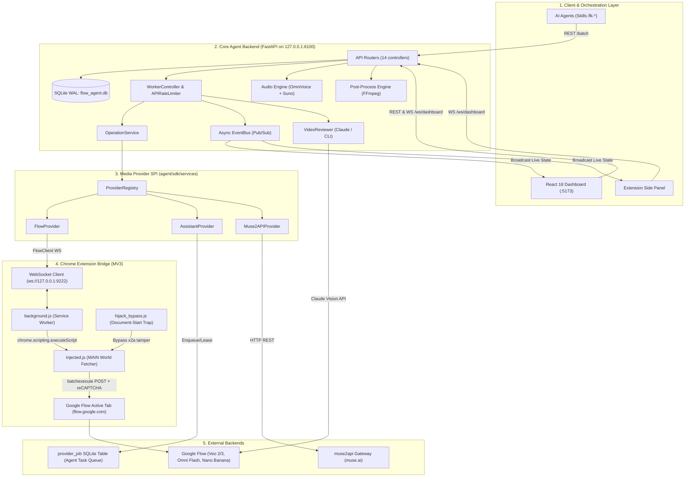
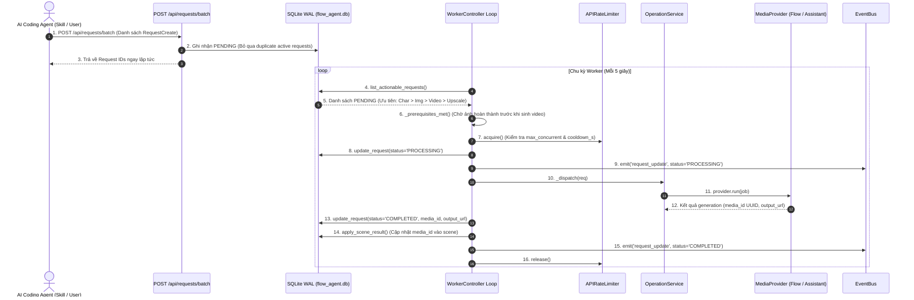
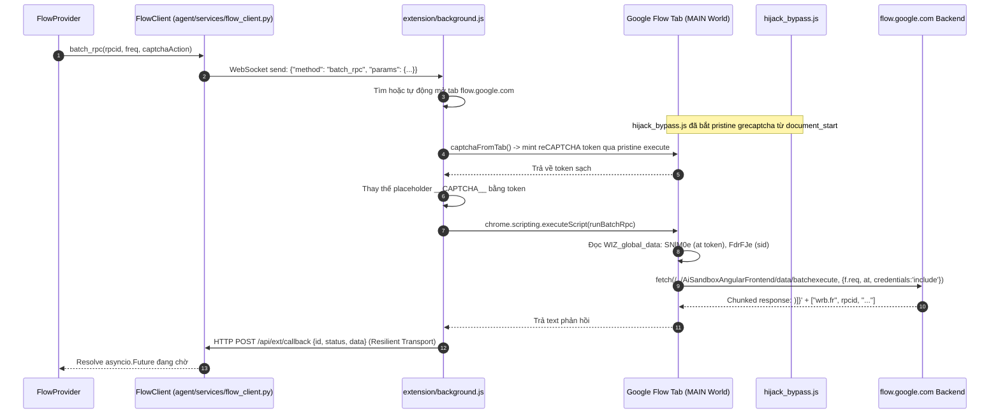
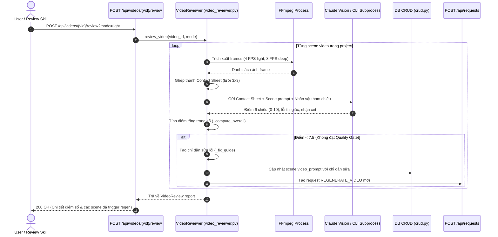
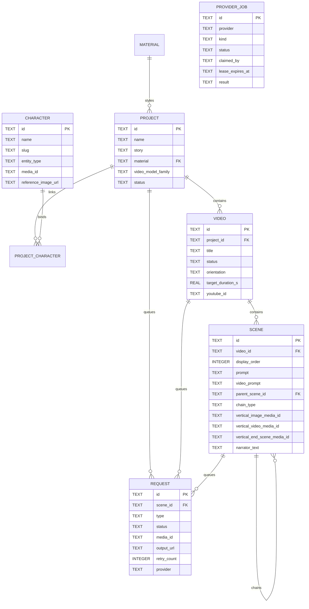

# BÁO CÁO TOÀN DIỆN: REVERSE-ENGINEERING & ARCHITECTURE ANALYSIS HỆ THỐNG FLOW KIT

- **Chức danh thực hiện:** Senior Software Architect & Repository Reverse Engineering Engineer
- **Đối tượng khảo sát:** Toàn bộ Codebase `flowkit-main` (`d:\Năm 3\flowkit-main`)
- **Thời gian phân tích:** 2026-11-01
- **Trạng thái lưu trữ:** Tài nguyên phân tích chi tiết được lưu trữ tại [repository-analysis/](file:///d:/Năm%203/flowkit-main/repository-analysis/)

---

## MỤC LỤC
1. [Phase 0: Tool & Capability Discovery](#phase-0-tool--capability-discovery)
2. [Phase 1: Repository Discovery & Inventory](#phase-1-repository-discovery--inventory)
3. [Phase 2: Architecture Reverse Engineering](#phase-2-architecture-reverse-engineering)
4. [Phase 3: End-to-End Workflow Analysis](#phase-3-end-to-end-workflow-analysis)
5. [Phase 4: Module Deep Dive & Responsibilities](#phase-4-module-deep-dive--responsibilities)
6. [Phase 5: Data Architecture & State Management](#phase-5-data-architecture--state-management)
7. [Phase 6: API, Event & Integration Analysis](#phase-6-api-event--integration-analysis)
8. [Phase 7: Execution, Build, Test & Deployment](#phase-7-execution-build-test--deployment)
9. [Phase 8: Design Decisions & Codebase Evolution](#phase-8-design-decisions--codebase-evolution)
10. [Phase 9: Customization & Extension Strategy](#phase-9-customization--extension-strategy)
11. [Phase 10: Knowledge Base Deliverables](#phase-10-knowledge-base-deliverables)
12. [Giải đáp 12 Câu hỏi Vận hành & Tùy biến Cốt lõi](#giải-đáp-12-câu-hỏi-vận-hành--tùy-biến-cốt-lõi)

---

# PHASE 0: TOOL & CAPABILITY DISCOVERY

Trước khi bắt đầu phân tích mã nguồn, toàn bộ môi trường công cụ, MCP server, runtime shell và skills đã được khảo sát kỹ lưỡng:

| Tool / Skill / MCP | Mục đích | Có sử dụng? | Lý do |
|---|---|---|---|
| **`codebase-memory-mcp`** | Lập đồ thị tri thức (AST, Call Graph, Symbols, Dependencies, Cypher queries) | **CÓ** | Đã chỉ mục toàn bộ repository (`index_repository` với 39.320 nodes, 61.133 edges) để truy vết call graph, fan-in/fan-out, entry points và hotspots. |
| **`run_command` (PowerShell)** | Khảo sát filesystem, kiểm tra runtime Python, binary FFmpeg, SQLite, kiểm thử unittest | **CÓ** | Xác thực môi trường chạy thực tế, đọc cấu trúc cây thư mục, kiểm tra import và thư viện cài đặt. |
| **`read_file`** | Đọc source code chi tiết, config manifests, DDL schemas | **CÓ** | Đọc trực tiếp implementation và truy vết chính xác từng dòng code (Line numbers). |
| **`write_file`** | Xuất bộ tài liệu phân tích kỹ thuật chuẩn (`repository-analysis/`) | **CÓ** | Lưu trữ toàn bộ 14 tài liệu markdown và 4 sơ đồ Mermaid vào codebase phục vụ bảo trì dài hạn. |
| **`search_web`** | Tra cứu tài liệu và specs bên ngoài nếu thiếu dữ liệu | **KHÔNG** | Codebase nội bộ đã cung cấp đầy đủ thông tin chi tiết về wire protocol của Google Flow và các third-party services. |
| **Marketplace / Plugins** | Cài đặt thêm plugin ngoài | **KHÔNG** | Môi trường hiện tại đã có đầy đủ Python 3.12, SQLite, Node/Vite và MCP servers cần thiết. |

---

# PHASE 1: REPOSITORY DISCOVERY & INVENTORY

### 1. Technology Stack & Runtime
- **Backend Runtime:** Python 3.10 – 3.12 (Môi trường đang kích hoạt: `Python 3.12.10`), kiến trúc bất đồng bộ thuần túy (`asyncio`, `FastAPI`, `aiosqlite`, `aiohttp`, `httpx`).
- **Browser Extension Bridge:** JavaScript (ES2022) chạy trên nền tảng **Chrome Manifest V3**, kết hợp Service Worker, DeclarativeNetRequest và Script Injection vào `MAIN` world của tab `flow.google.com`.
- **Frontend Dashboard:** React 18.3, TypeScript 5.5, Vite 5.4, Tailwind CSS 3.4, Radix UI Primitives / shadcn/ui.
- **Cơ sở dữ liệu:** SQLite 3 chạy chế độ **Write-Ahead Logging (`PRAGMA journal_mode=WAL`)** với foreign keys (`PRAGMA foreign_keys=ON`) qua thư viện `aiosqlite`.
- **Hệ thống xử lý ngoại vi:** FFmpeg / FFprobe (audio/video normalization, trim, merge), OmniVoice (`k2-fsa/OmniVoice` qua subprocess), Suno AI API (`api.sunoapi.org`), YouTube Data API v3.

### 2. Cấu trúc Thư mục & Danh mục Module

```text
flowkit-main/
├── agent/                         # Core Python FastAPI Backend
│   ├── api/                       # 14 REST Route Controllers (projects, scenes, requests, videos...)
│   ├── db/                        # SQLite DDL, WAL initialization & CRUD operations
│   ├── models/                    # Pydantic Schemas & DTOs
│   ├── sdk/                       # Abstract Architecture: Repository, MediaProvider SPI, OperationService
│   ├── services/                  # Business Logic: FlowClient, FlowBatch, VideoReviewer, TTS, Suno, FFmpeg
│   ├── utils/                     # Path utilities & slugification
│   ├── worker/                    # Background WorkerController, APIRateLimiter, AssistantWorker
│   ├── config.py                  # Cấu hình tập trung & Environment Variables
│   ├── main.py                    # Entry point server (FastAPI + Extension WebSocket Server)
│   ├── models.json                # Dynamic Model Keys (Veo, Imagen, Nano Banana)
│   └── providers.json             # Dynamic Video Review CLI providers (claude, agy, codex)
├── dashboard/                     # React 18 SPA (Vite + Tailwind + shadcn/ui)
├── extension/                     # Chrome Extension (MV3) - WebSocket Client & In-Page RPC Runner
├── tools/                         # Scene Review Server (review_server.py:8200) & Review Board UI
├── youtube/                       # YouTube Data API v3 OAuth2 & Video Publishing Automation
├── skills/ & .agents/skills/      # 40+ AI Agent Workflow Instructions (/fk-*)
├── tests/                         # 27 bộ Unit Test bao phủ toàn diện
└── repository-analysis/           # Bộ tài liệu Reverse-Engineering toàn diện
```

### 3. Entry Points của Ứng dụng
1. **Backend Server Entry Point:** [`agent/main.py`](file:///d:/Năm%203/flowkit-main/agent/main.py)  
   Khởi động FastAPI HTTP server trên `http://127.0.0.1:8100` và WebSocket Server trên `ws://127.0.0.1:9222` (`run_ws_server`) dành riêng cho Chrome Extension kết nối vào. Khởi động worker ngầm `WorkerController.start()`.
2. **Chrome Extension Entry Point:** [`extension/manifest.json`](file:///d:/Năm%203/flowkit-main/extension/manifest.json) -> [`extension/background.js`](file:///d:/Năm%203/flowkit-main/extension/background.js)  
   Service Worker MV3 tự động kết nối WebSocket vào `ws://127.0.0.1:9222`, duy trì alarm `keepAlive`.
3. **Web Dashboard Entry Point:** [`dashboard/src/main.tsx`](file:///d:/Năm%203/flowkit-main/dashboard/src/main.tsx)  
   Single Page Application chạy qua Vite (`npm run dev`), kết nối trực tiếp đến `/ws/dashboard` để cập nhật trạng thái pipeline theo thời gian thực.
4. **Standalone Assistant Worker Entry Point:** [`agent/worker/assistant_worker.py`](file:///d:/Năm%203/flowkit-main/agent/worker/assistant_worker.py)  
   Worker chạy độc lập qua CLI (`python -m agent.worker.assistant_worker`), long-poll endpoint `/api/provider-jobs/wait-next` để xử lý các task được giao cho AI agent mà không cần trình duyệt Chrome.
5. **Review Board Entry Point:** [`tools/review_server.py`](file:///d:/Năm%203/flowkit-main/tools/review_server.py)  
   Micro HTTP server chạy trên cổng `8200`, phục vụ giao diện HTML review video side-by-side.

---

# PHASE 2: ARCHITECTURE REVERSE ENGINEERING

### 1. Kiến trúc Tổng thể: Layered Modular Monolith kết hợp Out-of-Process Browser Bridge

Flow Kit giải quyết bài toán cốt lõi: **Google Flow (`flow.google.com`) không có public API chính thức, không cấp long-lived token, và áp dụng cơ chế chống bot bằng Enterprise reCAPTCHA cùng script phát hiện extension monkeypatch.**

Hệ thống được thiết kế theo mô hình **Hexagonal / Plugin Architecture (Provider SPI)** kết hợp với **Out-of-Process Browser Execution Bridge**:



### 2. Cơ chế Anti-Tamper Bypass của Chrome Extension (`hijack_bypass.js`)
Phát hiện reverse-engineering cốt lõi trong source code:
Google Flow triển khai script `boq_labs-ai-sandbox-frontend_20260922.00_p0` chứa hàm `x2a`. Hàm này ghi đè `grecaptcha.enterprise.execute` của trang, ép tham số `action: "extension_hijack_detected"`. Hậu quả là token sinh ra bị Google backend phát hiện và trả về lỗi `PUBLIC_ERROR_UNUSUAL_ACTIVITY`.

Flow Kit vô hiệu hóa cơ chế này bằng [`extension/hijack_bypass.js`](file:///d:/Năm%203/flowkit-main/extension/hijack_bypass.js):
- Chạy ở chế độ `run_at: "document_start"` trong `world: "MAIN"`.
- Thiết lập trap 3 tầng bằng `Object.defineProperty` trên `window.grecaptcha`, `grecaptcha.enterprise`, và `enterprise.execute`.
- Ngay khi script reCAPTCHA gốc vừa gán hàm `execute`, trap lập tức bắt lấy con trỏ hàm nguyên bản (pristine function), lưu vào `window.__fk_hijack`, và tự động dọn dẹp các descriptor (`cleanAllTraps`) để Google script không phát hiện dấu vết.
- Khi cần mint token cho generation, extension gọi hàm nguyên bản trong `window.__fk_hijack`, tạo ra reCAPTCHA token hoàn toàn hợp lệ.

---

# PHASE 3: END-TO-END WORKFLOW ANALYSIS

### Workflow 1: Asynchronous Batch Request Pipeline & Worker Dispatch
Khách hàng (Agent/CLI/User) gửi yêu cầu sinh ảnh/video hàng loạt. Hệ thống xử lý thông qua hàng đợi bất đồng bộ có kiểm soát concurrency.



| Bước | Module | File | Hàm | Input | Output | Trách nhiệm |
|---|---|---|---|---|---|---|
| 1 | API | [`agent/api/requests.py`](file:///d:/Năm%203/flowkit-main/agent/api/requests.py#L64) | `create_batch()` | `BatchRequestCreate` | `list[Request]` | Ingest danh sách requests nguyên tử, đồng bộ video orientation, idempotent deduplication. |
| 2 | Worker | [`agent/worker/processor.py`](file:///d:/Năm%203/flowkit-main/agent/worker/processor.py#L136) | `_run_loop()` | - | PENDING requests | Quét hàng đợi, áp dụng độ ưu tiên, kiểm tra sức chứa provider. |
| 3 | Worker | [`agent/worker/processor.py`](file:///d:/Năm%203/flowkit-main/agent/worker/processor.py#L229) | `_prerequisites_met()` | `req`, `orientation` | `bool` | Hoãn request nếu media thượng nguồn chưa sẵn sàng (chưa có ảnh thì hoãn video 30s). |
| 4 | Throttle | [`agent/worker/processor.py`](file:///d:/Năm%203/flowkit-main/agent/worker/processor.py#L36) | `APIRateLimiter.acquire()` | - | - | Giới hạn concurrency và cooldown theo từng provider (Flow: 5 concurrent, 10s cooldown). |
| 5 | SDK | [`agent/sdk/services/operations.py`](file:///d:/Năm%203/flowkit-main/agent/sdk/services/operations.py#L93) | `_run_provider_job()` | `ProviderJob` | Result dict | Xác định provider tương ứng, kiểm tra capabilities, thực thi job. |
| 6 | Result | [`agent/sdk/services/result_handler.py`](file:///d:/Năm%203/flowkit-main/agent/sdk/services/result_handler.py) | `apply_scene_result()` | Result DTO | DB update | Cập nhật URL và media UUID vào bảng `scene`. |

---

### Workflow 2: Google Flow Wire Execution & In-Page RPC
Cách lệnh từ backend đi xuyên qua WebSocket sang trình duyệt và thực thi bằng cookies của người dùng:



---

### Workflow 3: Automated Video Quality Review & Auto-Regeneration Loop
Đánh giá chất lượng thị giác tự động và tự sửa prompt khi không đạt yêu cầu:



---

# PHASE 4: MODULE DEEP DIVE & RESPONSIBILITIES

### Phân loại Module theo Trọng trách Kiến trúc

| Module | Phân loại | Mức độ phụ thuộc (Coupling) | Rủi ro khi chỉnh sửa |
|---|---|---|---|
| `agent/api/` | Inbound Controllers | Thấp -> Vừa (phụ thuộc `crud.py` và `models/`) | Thấp. Có thể thêm endpoint mới độc lập. |
| `agent/db/` | Persistence & Migrations | Rất cao (Tất cả module đều phụ thuộc vào schema) | **Rất cao**. Thay đổi cấu trúc bảng ảnh hưởng toàn hệ thống. |
| `agent/models/` | Data Contracts | Cao (Được dùng bởi API, DB, Worker, SDK) | Vừa. Cần đảm bảo tương thích ngược. |
| `agent/sdk/` | Provider Abstraction SPI | Thấp (Thiết kế theo Open-Closed Principle) | Thấp. Thêm provider mới bằng cách implement `MediaProvider`. |
| `agent/services/flow_batch.py` | Google Wire Protocol Engine | Độc lập về code, nhưng phụ thuộc chặt vào Google Flow API | **Cực cao**. Google đổi wire format sẽ làm hỏng generation. |
| `agent/worker/processor.py` | Concurrency & Queue Dispatcher | Cao (Điều phối luồng dữ liệu chính) | **Rất cao**. Lỗi logic có thể làm treo hàng đợi hoặc bị Google ban IP. |
| `extension/` | In-Browser Execution Bridge | Phụ thuộc vào DOM và cơ chế bảo mật của Google | **Cực cao**. Script Google thay đổi sẽ ảnh hưởng reCAPTCHA trap. |
| `youtube/` | External Publisher | Rất thấp (Độc lập ở giai đoạn cuối pipeline) | Thấp. Chỉ ảnh hưởng việc upload video lên YouTube. |

---

# PHASE 5: DATA ARCHITECTURE & STATE MANAGEMENT

### 1. Mô hình Dữ liệu Tổng thể
Cơ sở dữ liệu SQLite [`flow_agent.db`](file:///d:/Năm%203/flowkit-main/flow_agent.db) được quản lý qua [`agent/db/schema.py`](file:///d:/Năm%203/flowkit-main/agent/db/schema.py).



### 2. Quản lý Trạng thái & Vòng đời Thực thể
- **Request State Machine:**
  `PENDING` -> `PROCESSING` -> (`COMPLETED` | `FAILED`)
  - Khi khởi động server, hàm `_cleanup_stale_processing()` tự động đưa các request bị kẹt ở `PROCESSING` từ phiên làm việc trước trở về `PENDING`.
- **Provider Job Leasing Model:**
  `QUEUED` -> `CLAIMED` -> `RUNNING` -> (`SUCCEEDED` | `FAILED` | `CANCELLED`)
  - Cho phép phân phối công việc cho các agent ngoại vi. Nếu một agent nhận job nhưng bị crash, trường `lease_expires_at` hết hạn sẽ đưa job về trạng thái có thể được nhận lại (reclaimable), chống treo hàng đợi.

---

# PHASE 6: API, EVENT & INTEGRATION ANALYSIS

### Bảng Tổng hợp Tích hợp Dịch vụ

| Integration | Purpose | Entry Point / File | Giao thức / Data Contract | Cơ chế Xử lý Lỗi |
|---|---|---|---|---|
| **Google Flow** | Sinh ảnh và video (Veo 2/3, Omni Flash, Nano Banana) | [`agent/services/flow_batch.py`](file:///d:/Năm%203/flowkit-main/agent/services/flow_batch.py), [`extension/background.js`](file:///d:/Năm%203/flowkit-main/extension/background.js) | Google `batchexecute` RPCs (`f.req`) kèm Enterprise reCAPTCHA | Tự động hồi sinh tab bị đóng, kích hoạt cooldown 120s khi gặp `UNUSUAL_ACTIVITY`. |
| **Anthropic Claude** | AI Vision review chất lượng video | [`agent/services/video_reviewer.py`](file:///d:/Năm%203/flowkit-main/agent/services/video_reviewer.py) | JSON qua Claude API hoặc CLI subprocess | Tự động chuyển đổi giữa Claude API key và CLI providers (`claude`, `agy`, `codex`). |
| **Suno AI** | Sinh nhạc nền tự động | [`agent/services/suno.py`](file:///d:/Năm%203/flowkit-main/agent/services/suno.py) | REST API (`api.sunoapi.org`) | Webhook callback kết hợp long-poll tối đa 600s. |
| **OmniVoice** | Đọc lời thoại narrator | [`agent/services/tts.py`](file:///d:/Năm%203/flowkit-main/agent/services/tts.py) | Subprocess isolated Python CLI | Timeout subprocess 120s; tự động padding đuôi âm thanh để không bị nuốt âm cuối. |
| **YouTube API** | Tự động xuất bản và hẹn giờ video | [`youtube/upload.py`](file:///d:/Năm%203/flowkit-main/youtube/upload.py) | Resumable chunked upload qua Google API Client | Exponential backoff khi mạng gián đoạn, cache OAuth token theo channel. |
| **muse.ai** | Backend sinh video thay thế | [`agent/services/muse2api_client.py`](file:///d:/Năm%203/flowkit-main/agent/services/muse2api_client.py) | OpenAI-compatible HTTP Gateway | Failover tự động qua tối đa 3 tài khoản với timeout 1800s. |

---

# PHASE 7: EXECUTION, BUILD, TEST & DEPLOYMENT

### 1. Trình tự Khởi chạy Local Chuẩn
1. **Khởi động Backend Agent:**
   ```bash
   python -m agent.main
   ```
   - Server lắng nghe tại `http://127.0.0.1:8100` và WebSocket tại `ws://127.0.0.1:9222`.
   - SQLite tự động chạy migration và mở kết nối WAL.
   - Worker bắt đầu vòng lặp xử lý ngầm.
2. **Kích hoạt Chrome Extension Bridge:**
   - Mở Chrome: `chrome://extensions/` -> Bật **Developer mode** -> Chọn **Load unpacked** thư mục `flowkit-main/extension/`.
   - Mở tab `https://flow.google.com/` và đăng nhập tài khoản Google.
   - Extension kết nối vào `ws://127.0.0.1:9222`, nhận `_CALLBACK_SECRET` và sẵn sàng nhận lệnh RPC.
3. **Mở Dashboard (Tùy chọn):**
   ```bash
   cd dashboard && npm run dev
   ```
   - Truy cập giao diện tại `http://localhost:5173`.
4. **Mở Review Board (Tùy chọn):**
   ```bash
   python tools/review_server.py 8200
   ```

### 2. Chiến lược Kiểm thử (Testing)
Thư mục [`tests/unit/`](file:///d:/Năm%203/flowkit-main/tests/unit/) chứa 27 bộ test suite kiểm tra:
- Wire protocol golden tests: [`test_flow_batch_golden.py`](file:///d:/Năm%203/flowkit-main/tests/unit/test_flow_batch_golden.py).
- Rate limiting & cooldown: [`test_flow_global_throttle.py`](file:///d:/Năm%203/flowkit-main/tests/unit/test_flow_global_throttle.py).
- Provider job queue & leasing: [`test_provider_jobs.py`](file:///d:/Năm%203/flowkit-main/tests/unit/test_provider_jobs.py).
- Chaining & Video assembly: [`test_video_assemble.py`](file:///d:/Năm%203/flowkit-main/tests/unit/test_video_assemble.py).
- Video review & auto-regen: [`test_review_regenerate.py`](file:///d:/Năm%203/flowkit-main/tests/unit/test_review_regenerate.py).

---

# PHASE 8: DESIGN DECISIONS & CODEBASE EVOLUTION

Mặc dù repository là bản snapshot không có thư mục `.git`, các bằng chứng kỹ thuật trong code (`ARCHITECTURE.md`, `agent/services/flow_batch.py`, migration logs) cho thấy 4 quyết định thiết kế then chốt:

1. **Cuộc di cư lớn từ REST sang batchexecute (Tháng 9/2026):**  
   Google đóng bearer token, chuyển toàn bộ frontend sang `flow.google.com` với cơ chế `batchexecute` kèm token CSRF per-page (`SNlM0e`). Flow Kit loại bỏ proxy REST, chuyển sang xây dựng payload `f.req` và thực thi trực tiếp trong tab `MAIN` world qua Chrome Extension.
2. **Kỹ thuật bẫy thuộc tính 3 tầng (`hijack_bypass.js`):**  
   Khi Google đưa hàm `x2a` vào để phá hoại extension bằng cách tiêm `extension_hijack_detected`, đội ngũ phát triển không chọn cách de-obfuscate script của Google mà bẫy hàm `execute` gốc ngay tại microtask đầu tiên khi vừa được khởi tạo (`document_start`), triệt tiêu hoàn toàn khả năng phát hiện của Google.
3. **Tách rời Core Worker qua Provider SPI:**  
   Việc chuyển từ hardcoded Google Flow sang `MediaProvider` interface và bảng `provider_job` cho phép hệ thống chạy độc lập hoàn toàn với trình duyệt khi cần, hỗ trợ thêm các model như muse.ai hoặc local AI models mà không phải sửa logic nghiệp vụ cốt lõi.
4. **Cơ chế Dual-Transport (WebSocket + HTTP Callback):**  
   Khi render video dài (60-180s), WebSocket của trình duyệt có nguy cơ bị đóng/ngắt. Flow Kit thiết kế thêm route `POST /api/ext/callback` với secret token để extension POST kết quả về ngay cả khi WebSocket bị đứt.

---

# PHASE 9: CUSTOMIZATION & EXTENSION STRATEGY

### 1. Bản đồ Rủi ro khi Thay đổi Hệ thống

```text
[SAFE TO MODIFY]
├── agent/materials.py             -> Thêm phong cách mỹ thuật (3d_pixar, anime, anime_chibi...)
├── agent/models.json              -> Cập nhật wire key cho model mới (Veo 3, Nano Banana Ultra)
├── agent/providers.json           -> Đổi CLI provider cho video reviewer
└── skills/ & .agents/skills/      # Thêm quy trình làm việc cho AI agent

[EXTENSION SPI - LOW/MED RISK]
├── agent/sdk/services/provider_base.py  -> Định nghĩa provider mới
└── agent/sdk/services/registry.py       -> Đăng ký provider mới vào hệ sinh thái

[MODERATE RISK]
├── agent/services/video_reviewer.py     -> Thay đổi trọng số hoặc tiêu chí chấm điểm video
├── agent/services/tts.py                -> Tích hợp thêm engine đọc giọng nói (ElevenLabs)
└── agent/api/                           -> Thêm REST endpoints mới

[HIGH RISK / CRITICAL - DO NOT TOUCH UNLESS RE-ENGINEERING]
├── agent/worker/processor.py            -> Vòng lặp rate limit và điều phối hàng đợi
├── agent/db/schema.py & crud.py         -> Quản lý khóa ngoại, WAL checkpoint và transaction
├── agent/services/flow_batch.py         -> Wire protocol của Google
└── extension/hijack_bypass.js           -> Anti-bot reCAPTCHA trap
```

### 2. Hướng dẫn Mở rộng: Thêm một Media Provider mới (Ví dụ: ComfyUI / OpenAI Sora)
Để thêm một backend sinh media mới mà **hoàn toàn không sửa core logic hay DB schema**:
1. Tạo file mới: `agent/sdk/services/comfy_provider.py` kế thừa từ `MediaProvider` ([`agent/sdk/services/provider_base.py`](file:///d:/Năm%203/flowkit-main/agent/sdk/services/provider_base.py)):
   - Khai báo `capabilities` (hỗ trợ image, video, max_concurrent, cooldown_s).
   - Implement `is_available()` để check health server ComfyUI.
   - Implement `run(job: ProviderJob)` để gọi API sinh file và trả về `{"output_url": "file:///...", "media_id": "<uuid>"}`.
2. Đăng ký provider vào [`agent/sdk/services/registry.py`](file:///d:/Năm%203/flowkit-main/agent/sdk/services/registry.py):
   ```python
   self._providers["comfyui"] = ComfyProvider()
   ```
3. Trong cấu hình [`agent/config.py`](file:///d:/Năm%203/flowkit-main/agent/config.py), đặt `DEFAULT_PROVIDER = "comfyui"` hoặc truyền `"provider": "comfyui"` trong request.

---

# PHASE 10: KNOWLEDGE BASE DELIVERABLES

Toàn bộ tài liệu chi tiết đã được tự động sinh và lưu trữ tại thư mục [repository-analysis/](file:///d:/Năm%203/flowkit-main/repository-analysis/):

- [`00-executive-summary.md`](file:///d:/Năm%203/flowkit-main/repository-analysis/00-executive-summary.md): Tóm tắt chiến lược, số liệu & phát hiện cốt lõi.
- [`01-repository-inventory.md`](file:///d:/Năm%203/flowkit-main/repository-analysis/01-repository-inventory.md): Chi tiết từng file, folder, entry points & trách nhiệm.
- [`02-technology-stack.md`](file:///d:/Năm%203/flowkit-main/repository-analysis/02-technology-stack.md): Runtime, thư viện, dependencies & tooling.
- [`03-system-architecture.md`](file:///d:/Năm%203/flowkit-main/repository-analysis/03-system-architecture.md): Các tầng kiến trúc, coupling, boundaries & sơ đồ tổng thể.
- [`04-module-deep-dive.md`](file:///d:/Năm%203/flowkit-main/repository-analysis/04-module-deep-dive.md): Phân tích sâu 7 module chính, functions, exceptions & risks.
- [`05-end-to-end-workflows.md`](file:///d:/Năm%203/flowkit-main/repository-analysis/05-end-to-end-workflows.md): 5 workflows E2E kèm sequence diagrams và bảng truy vết.
- [`06-data-architecture.md`](file:///d:/Năm%203/flowkit-main/repository-analysis/06-data-architecture.md): Phân tích DDL, ER diagram, state machines & WAL indexing.
- [`07-api-and-integrations.md`](file:///d:/Năm%203/flowkit-main/repository-analysis/07-api-and-integrations.md): Danh mục 14 REST routers, WebSocket protocols & third-parties.
- [`08-execution-and-deployment.md`](file:///d:/Năm%203/flowkit-main/repository-analysis/08-execution-and-deployment.md): Hướng dẫn chạy local, extension setup, env vars & troubleshooting.
- [`09-testing-and-quality.md`](file:///d:/Năm%203/flowkit-main/repository-analysis/09-testing-and-quality.md): 27 unit tests, fixtures, loop isolation & quality gates.
- [`10-git-history-and-decisions.md`](file:///d:/Năm%203/flowkit-main/repository-analysis/10-git-history-and-decisions.md): Tiến trình tiến hóa kiến trúc (REST -> batchexecute, anti-hijack).
- [`11-customization-guide.md`](file:///d:/Năm%203/flowkit-main/repository-analysis/11-customization-guide.md): Công thức từng bước tùy biến provider, model, style & audio.
- [`12-impact-analysis.md`](file:///d:/Năm%203/flowkit-main/repository-analysis/12-impact-analysis.md): Ma trận phụ thuộc, các kịch bản breaking changes & regression checklist.
- [`13-glossary.md`](file:///d:/Năm%203/flowkit-main/repository-analysis/13-glossary.md): Bảng thuật ngữ chuyên sâu & RPC IDs của Google Flow.
- Thư mục sơ đồ Mermaid độc lập: [`diagrams/`](file:///d:/Năm%203/flowkit-main/repository-analysis/diagrams/) (`system-architecture.mmd`, `module-dependencies.mmd`, `main-workflows.mmd`, `data-model.mmd`).

---

# GIẢI ĐÁP 12 CÂU HỎI VẬN HÀNH & TÙY BIẾN CỐT LÕI

1. **Hệ thống này hoạt động như thế nào từ đầu đến cuối?**  
   User/Agent tạo Project và Character Bible -> Gửi batch requests tạo ảnh scene -> Worker điều phối sinh ảnh qua Google Flow tab (hoặc Assistant) -> Gửi batch requests tạo video từ ảnh (kèm chaining frame cuối của cảnh trước vào cảnh sau) -> Video Reviewer chấm điểm video bằng Claude Vision; nếu điểm < 7.5 tự động sửa prompt và sinh lại -> Engine TTS đọc lời thoại bằng OmniVoice -> FFmpeg chuẩn hóa codec, cắt theo tiếng đọc và ghép thành video hoàn chỉnh -> YouTube module tự động upload theo lịch.
2. **Application bắt đầu chạy từ đâu?**  
   Backend bắt đầu tại [`agent/main.py`](file:///d:/Năm%203/flowkit-main/agent/main.py) (FastAPI lifespan khởi tạo SQLite DB, mở WebSocket server cổng 9222 và khởi động WorkerController loop). Extension bắt đầu tại [`extension/background.js`](file:///d:/Năm%203/flowkit-main/extension/background.js) tự kết nối vào WebSocket của agent.
3. **Những module nào quan trọng nhất?**  
   - [`agent/worker/processor.py`](file:///d:/Năm%203/flowkit-main/agent/worker/processor.py): Trái tim điều phối hàng đợi và rate limiter.
   - [`agent/services/flow_batch.py`](file:///d:/Năm%203/flowkit-main/agent/services/flow_batch.py): Động cơ dịch wire protocol Google Flow.
   - [`extension/hijack_bypass.js`](file:///d:/Năm%203/flowkit-main/extension/hijack_bypass.js): Lá chắn vượt qua cơ chế chống bot của Google.
   - [`agent/sdk/services/operations.py`](file:///d:/Năm%203/flowkit-main/agent/sdk/services/operations.py): Lớp điều phối logic nghiệp vụ media.
4. **Các module giao tiếp với nhau như thế nào?**  
   - Router -> Database CRUD: Async function calls qua `aiosqlite`.
   - Worker -> Extension: JSON-RPC qua WebSocket `ws://127.0.0.1:9222`, phản hồi qua WebSocket hoặc `POST /api/ext/callback`.
   - Worker -> Dashboard: Bi-directional pub/sub qua in-memory `event_bus` tới `/ws/dashboard`.
   - Worker -> Assistant ngoài: Bảng queue `provider_job` qua REST long-polling `/api/provider-jobs`.
5. **Một request hoặc user action đi qua những bước nào?**  
   User action -> API Router (`POST /api/requests/batch`) -> Ghi trạng thái `PENDING` vào DB -> Worker nhặt request, kiểm tra điều kiện tiên quyết (ví dụ: đã có ảnh chưa), lấy token rate limiter -> Đổi trạng thái `PROCESSING` -> Gọi `OperationService` -> Ủy quyền cho `MediaProvider` -> Gọi Chrome Extension thực thi RPC trong tab Flow -> Parse UUID kết quả -> Ghi `COMPLETED` vào DB và cập nhật bảng `scene` -> Bắn event qua `event_bus` lên UI Dashboard.
6. **Dữ liệu được xử lý và lưu trữ như thế nào?**  
   Lưu trữ tập trung trong SQLite `flow_agent.db` ở chế độ WAL. Mọi file media vật lý (video, audio, ảnh trích xuất, contact sheet) được lưu trữ tại thư mục `output/{project_name}/`.
7. **Workflow nào phụ thuộc vào workflow nào?**  
   Tạo Project & Character Bible -> Sinh ảnh Scene (phải đợi Character có media_id) -> Sinh Video (phải đợi Scene có image media_id) -> Upscale Video (phải đợi Video hoàn thành) -> Video Review -> Sinh TTS Narrator -> Cắt ghép FFmpeg Final -> Upload YouTube.
8. **Nếu muốn thay đổi một chức năng, phải bắt đầu từ file nào?**  
   - Đổi wire format / Model Google: [`agent/models.json`](file:///d:/Năm%203/flowkit-main/agent/models.json) và [`agent/services/flow_batch.py`](file:///d:/Năm%203/flowkit-main/agent/services/flow_batch.py).
   - Đổi quy tắc chấm điểm video: [`agent/services/video_reviewer.py`](file:///d:/Năm%203/flowkit-main/agent/services/video_reviewer.py).
   - Đổi định dạng render/ghép video: [`agent/services/post_process.py`](file:///d:/Năm%203/flowkit-main/agent/services/post_process.py).
   - Đổi phong cách ảnh: [`agent/materials.py`](file:///d:/Năm%203/flowkit-main/agent/materials.py).
9. **Nếu thêm một feature mới, nên đặt logic ở đâu?**  
   - Thêm backend sinh video mới: Tạo class mới kế thừa `MediaProvider` trong [`agent/sdk/services/`](file:///d:/Năm%203/flowkit-main/agent/sdk/services/) và đăng ký tại `registry.py`.
   - Thêm API quản lý mới: Tạo router mới trong [`agent/api/`](file:///d:/Năm%203/flowkit-main/agent/api/) và mount tại `agent/main.py`.
10. **Những thay đổi nào có thể gây breaking changes?**  
    - Sửa bảng `request` hoặc `scene` trong `schema.py` mà không viết migration script tái tạo bảng.
    - Tăng `FLOW_GENERATION_MAX_CONCURRENT` quá 5 hoặc giảm cooldown dưới 10s dẫn đến Google ban IP hoặc trả `UNUSUAL_ACTIVITY`.
    - Chỉnh sửa `hijack_bypass.js` làm hỏng việc bắt pristine reCAPTCHA.
11. **Làm thế nào để kiểm thử rằng customization không phá vỡ hệ thống?**  
    Chạy bộ test suite:
    ```bash
    pytest tests/unit/test_flow_batch_golden.py tests/unit/test_operations.py tests/unit/test_processor.py
    ```
    Và kiểm tra endpoint reCAPTCHA: `curl http://127.0.0.1:8100/api/ext/test-captcha`.
12. **Có thể mở rộng hệ thống theo hướng nào mà không cần sửa core?**  
    - Thêm provider mới (Midjourney, Runway, ComfyUI, ElevenLabs) thông qua SPI `MediaProvider`.
    - Thêm style ảnh mới qua API `POST /api/materials`.
    - Thêm workflow tự động cho agent thông qua các file skill Markdown trong thư mục `skills/`.
