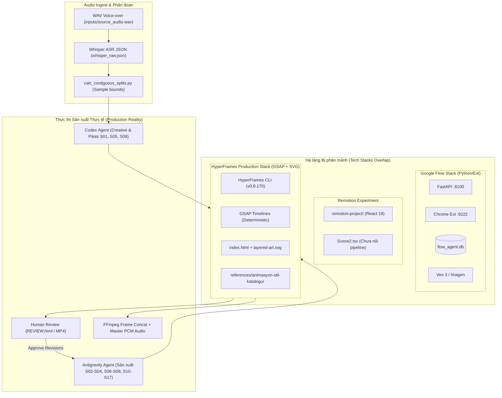
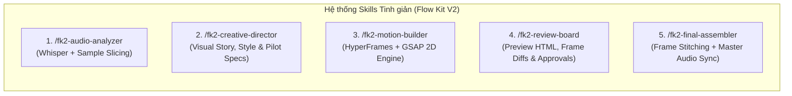
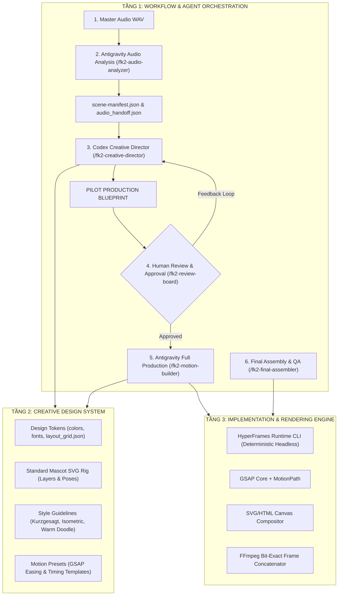

# FLOW KIT V2: BÁO CÁO KIẾN TRÚC TOÀN DIỆN, TINH GỌN HỆ THỐNG & NÂNG CẤP CHẤT LƯỢNG SẢN XUẤT VIDEO 2D

- **Chức danh thực hiện:** Principal Software Architect, AI Workflow Engineer & Creative Motion Systems Architect
- **Dự án:** Flow Kit V2 — Hệ thống sản xuất video hoạt hình giải thích 2D bằng AI Coding Agents
- **Trạng thái:** Kiến trúc & Phân tích Đề xuất (Chưa sửa source code theo Strict Rules)
- **Căn cứ phân tích:** Báo cáo Reverse-Engineering [`BAO_CAO_TOAN_DIEN_REVERSE_ENGINEERING.md`](file:///d:/Năm%203/flowkit-main/BAO_CAO_TOAN_DIEN_REVERSE_ENGINEERING.md), kiểm toán trực tiếp thư mục `videos/`, `references/`, `remotion-project/`, `hyperframes-demo/`, `skills/`, `.agents/skills/`, `agent/`, và `scratch/`.

---

## MỤC LỤC BÁO CÁO
1. [PART 1 — FLOW KIT CURRENT STATE (HIỆN TRẠNG HỆ THỐNG)](#part-1--flow-kit-current-state)
2. [PART 2 — PROBLEM ANALYSIS (PHÂN TÍCH VẤN ĐỀ & ĐIỂM NGHẼN)](#part-2--problem-analysis)
3. [PART 3 — SIMPLIFICATION (MA TRẬN TINH GỌN & THU GỌN HỆ THỐNG)](#part-3--simplification)
4. [PART 4 — CREATIVE QUALITY UPGRADE (KHOẢNG TRỐNG CHẤT LƯỢNG HÌNH ẢNH & CHUYỂN ĐỘNG)](#part-4--creative-quality-upgrade)
5. [PART 5 — FLOW KIT V2 PROPOSAL (THIẾT KẾ KIẾN TRÚC & QUY TRÌNH MỤC TIÊU)](#part-5--flow-kit-v2-proposal)
6. [PART 6 — IMPLEMENTATION ROADMAP (LỘ TRÌNH THỰC HIỆN TỪNG BƯỚC)](#part-6--implementation-roadmap)
7. [PART 7 — OPEN QUESTIONS & DECISION GATE (CÁC QUYẾT ĐỊNH CẦN PHÊ DUYỆT)](#part-7--open-questions--decision-gate)

---

# PART 1 — FLOW KIT CURRENT STATE

### 1. Phân định Thực tế: "Sự phân đôi bản sắc" (Identity Split) trong Codebase
Qua đối chiếu giữa [`BAO_CAO_TOAN_DIEN_REVERSE_ENGINEERING.md`](file:///d:/Năm%203/flowkit-main/BAO_CAO_TOAN_DIEN_REVERSE_ENGINEERING.md) và thực tế các dự án sản xuất gần nhất (`videos/VIDEO-33-director-pilot/`, `videos/tran-minh-nhat-director-handoff/`, `scratch/scene_routing.md`), hệ thống Flow Kit hiện tại thực chất đang tồn tại **hai thế giới song song**:

- **Hệ thống AI Video Plate (Google Flow Stack):**
  - Gồm FastAPI backend [`agent/`](file:///d:/Năm%203/flowkit-main/agent/) (cổng 8100), Chrome Extension [`extension/`](file:///d:/Năm%203/flowkit-main/extension/) (bẫy reCAPTCHA `hijack_bypass.js`), SQLite [`flow_agent.db`](file:///d:/Năm%203/flowkit-main/flow_agent.db) và ~30 skills dạng `fk-*`.
  - Mục đích ban đầu: Tự động hóa prompt sinh video người thật/3D trên nền tảng `flow.google.com` (Veo 2/3, Imagen).
- **Hệ thống 2D Motion Graphics (HyperFrames & Animation Stack):**
  - Gồm HyperFrames engine CLI (`npx hyperframes@0.8.170`), GSAP runtime, SVG layered rendering, HTML/Canvas compositions, thư viện tham khảo [`references/animasyon-stil-katalogu`](file:///d:/Năm%203/flowkit-main/references/animasyon-stil-katalogu/) và các project thực tế tại [`videos/`](file:///d:/Năm%203/flowkit-main/videos/).
  - Mục đích: Sản xuất video hoạt hình 2D, giải thích giáo dục/marketing có nhân vật mascot và typography tiếng Việt.

> [!IMPORTANT]
> **Phát hiện xác minh (VERIFIED):**  
> Trong dự án thực tế gần nhất ([`videos/VIDEO-33-director-pilot/TECHNICAL_HANDOFF.md#L43`](file:///d:/Năm%203/flowkit-main/videos/VIDEO-33-director-pilot/TECHNICAL_HANDOFF.md#L43) và [`scratch/scene_routing.md#L9-L25`](file:///d:/Năm%203/flowkit-main/scratch/scene_routing.md#L9-L25)), **100% các phân cảnh đều được phân luồng là `HF_ONLY`** (HyperFrames Only). Toàn bộ hạ tầng Google Flow (FastAPI server 8100, WebSocket 9222, Chrome extension, rate limiter) hoàn toàn **không được kích hoạt** để sinh video 2D. Toàn bộ video hoàn chỉnh được sinh bằng vector SVG + GSAP + HyperFrames CLI.

### 2. Sơ đồ Kiến trúc & Luồng Dữ liệu Hiện trạng



### 3. Đối chiếu: Workflow Mong muốn vs Workflow Thực tế

| Giai đoạn | Workflow Mong muốn của User | Implementation Thực tế trong Codebase | Tình trạng Đối chiếu |
|---|---|---|---|
| **Step 1: Audio Input** | Cung cấp file audio voice-over hoàn thiện | Đặt tại `inputs/source_audio.wav` (PCM 24kHz Mono). | **VERIFIED** — Khớp hoàn toàn. |
| **Step 2: Antigravity Audio Analysis** | Phân tích audio, chia cảnh, timestamps, timestamps cấu trúc | Đang dùng script rời rạc trong `scratch/` (`transcribe_step1.py`, `analyze_splits.py`) sinh `whisper_raw.json` và `audio_handoff.json`. | **INFERRED** — Chưa được chuẩn hóa thành tool tự động duy nhất; nhiều script thừa. |
| **Step 3: Codex Pilot** | Thiết kế kịch bản visual, style, animation và dựng pilot | Codex tạo folder director-pilot (`videos/VIDEO-33-director-pilot/`), sinh storyboard JSON/MD và render 3 cảnh pilot (S01, S05, S09). | **VERIFIED** — Khớp, nhưng tài liệu bàn giao quá cồng kềnh (hơn 20 file MD/JSON). |
| **Step 4: Human Approval** | User review pilot, đưa feedback chỉnh sửa | Xem qua `REVIEW.html` (HTTP server 8766), phản hồi loop nhiều lần (v1 -> v5). | **VERIFIED** — Đang vận hành hiệu quả nhưng hoàn toàn thủ công. |
| **Step 5: Antigravity Full Production** | Dùng pilot đã duyệt sản xuất các cảnh còn lại | Antigravity nhận `ANTIGRAVITY_PROMPT.md`, đọc tokens và dựng tiếp 11-14 cảnh còn lại. | **VERIFIED** — Đã có tiền lệ tại `VIDEO-33` và `tran-minh-nhat`, nhưng prompt phải viết thủ công từng dự án. |
| **Step 6: Final Video** | Ghép các cảnh, đồng bộ audio master, render hoàn chỉnh | Dùng `planning/picture_frame_plan.json` ghép chính xác frame (30fps) và đè track audio master PCM. | **VERIFIED** — AV sync đạt 0.9999 correlation, không bị lệch tiếng. |

---

# PART 2 — PROBLEM ANALYSIS

### 1. Phức tạp thừa thãi & Mâu thuẫn Kiến trúc
1. **Instruction Conflict (Mâu thuẫn Chỉ dẫn Cốt lõi):**
   - File [`AGENTS.md`](file:///d:/Năm%203/flowkit-main/AGENTS.md) (dài hàng trăm dòng) mở đầu bằng:  
     `Pre-flight: curl -s http://127.0.0.1:8100/health (extension_connected: true)`  
     và hàng loạt quy tắc bắt buộc của Google Flow (Media ID UUID, Portrait vs Landscape, Veo 3 camera prompts).
   - Trong khi đó, các dự án 2D explainer thực tế dùng 100% HyperFrames (`HF_ONLY`). Khi AI agent đọc `AGENTS.md`, nó liên tục bị phân tâm, cố gắng kiểm tra cổng 8100 hoặc sinh prompt theo kiểu quay phim điện ảnh (cinematic prompt) thay vì tập trung vào SVG layers, layout vector và GSAP easing!
2. **Sự tồn tại song song gây hoang mang của Remotion và HyperFrames:**
   - Trong thư mục gốc có [`remotion-project/`](file:///d:/Năm%203/flowkit-main/remotion-project/) chứa React 19, `@remotion/cli`, và skill `remotion-motion-director`, `remotion-to-hyperframes`.
   - Nhưng toàn bộ pipeline sản xuất thực tế đều chạy trên `hyperframes` CLI với HTML/SVG. Remotion chỉ là một thí nghiệm dở dang, không được kết nối vào luồng audio-to-final-video, gây lãng phí tài nguyên và làm agent bối rối khi chọn renderer.
3. **Hiểu nhầm về `Animasyon Stilleri`:**
   - Thư mục [`references/animasyon-stil-katalogu`](file:///d:/Năm%203/flowkit-main/references/animasyon-stil-katalogu) (Kurzgesagt, İzometrik, Bauhaus) là một **bộ sưu tập mã nguồn mẫu HTML/CSS/JS minh họa phong cách**, không phải là một rendering engine hoặc package npm có thể import.
   - Việc chỉ thị agent "dùng Animasyon Stilleri" mà không làm rõ cơ chế tái sử dụng dẫn đến việc agent cố tìm lệnh CLI hoặc cố copy nguyên mã nguồn trang web vào video.

### 2. Sự trùng lặp nghiêm trọng giữa các Skills
Repository hiện có hơn 40 skills trong `.agents/skills/` và `skills/`:
- **Ghép video:** Có cả [`fk-concat.md`](file:///d:/Năm%203/flowkit-main/skills/fk-concat.md) và [`fk-concat-fit-narrator.md`](file:///d:/Năm%203/flowkit-main/skills/fk-concat-fit-narrator.md).
- **Motion Graphics:** Có cả `motion-graphics`, `general-video`, `faceless-explainer`, `hyperframes-animation`, và `remotion-motion-director`.
- **Thiết kế phân cảnh:** Có `voice-to-scene-design`, `fk-edu-motion-explainer`, và `warm-doodle-video`. Cả ba đều cùng làm nhiệm vụ: chuyển voice thành visual story.

### 3. Điểm nghẽn trong Handoff từ Codex sang Antigravity
Hiện tại, để Codex bàn giao cho Antigravity, nó tạo ra một cấu trúc thư mục khổng lồ (`videos/VIDEO-33-director-pilot/`):
- `START_HERE.md`, `DIRECTOR_BRIEF.md`, `STORYBOARD.md`, `STORYBOARD.json`, `STORYBOARD.html`, `CONTINUITY.md`, `ASSET_PLAN.md`, `ASSET_PLAN.json`, `RESEARCH.md`, `TECHNICAL_HANDOFF.md`, `REVIEW_GUIDE.md`, `APPROVED_VERSIONS.md`, `CREDITS.md`, `ANTIGRAVITY_PROMPT.md`, `production_status.json`, v.v.
- **Hậu quả:** 
  - Dung lượng token quá tải: Antigravity phải đọc hàng chục ngàn token chỉ để nắm được bối cảnh.
  - Phân tán thông tin: Style tokens nằm ở một file, trạng thái duyệt nằm ở file khác, timing nằm ở file thứ ba.
  - Rủi ro không nhất quán: Khi User duyệt sửa một frame (ví dụ S05 từ v1 sang v5), Codex phải cập nhật thủ công vào 4-5 file markdown khác nhau, dễ dẫn đến hiện tượng Antigravity đọc phải phiên bản cũ.

---

# PART 3 — SIMPLIFICATION

### 1. Technology Capability Matrix

| Technology | Category | Current Usage | Điểm mạnh | Overlap / Hạn chế | Đề xuất (Action) |
|---|---|---|---|---|---|
| **HyperFrames CLI** (`hyperframes@0.8.x`) | Video Rendering Engine | Đang dùng chính để render MP4 (30fps), preview, check lint | Deterministic, seek-safe, native HTML/SVG/GSAP, render headless không giật | Phụ thuộc Node CLI npx, cần internet nếu không cache | **KEEP** (Động cơ sản xuất cốt lõi) |
| **GSAP (GreenSock)** | Animation Runtime | Đang dùng điều khiển toàn bộ timeline trong `index.html` | Easing chuẩn xác, timeline scrub/seek mượt, hỗ trợ stagger, nested timelines | Cần code JS chuẩn deterministic | **KEEP** (Engine chuyển động chính) |
| **SVG Layered Art** | 2D Graphic Format | Dùng cho toàn bộ props, mascot, background | Độ phân giải vô hạn, nhẹ, dễ animate từng nhóm `<g id="...">` qua CSS/GSAP | Cần vẽ hoặc tách lớp chuẩn vector | **KEEP** (Định dạng tài nguyên chính) |
| **Animasyon Stilleri Catalog** | Style Reference Library | Bộ mẫu tham khảo Kurzgesagt, Isometric, Bauhaus | Cung cấp triết lý chuyển động, palette và bố cục cao cấp | Chỉ là mẫu tĩnh (reference), không phải engine thực thi | **MERGE** (Đóng gói thành Design Presets) |
| **Remotion** (`remotion-project/`) | Alternative Video Engine | Thí nghiệm cô lập (`Scene2.tsx`), không chạy production | Hệ sinh thái React mạnh mẽ, hỗ trợ component hóa tốt | Hoàn toàn thừa thãi so với HyperFrames hiện tại; React 19 nặng | **REMOVE CANDIDATE** (Đóng gói cất kho lưu trữ, không nạp vào pipeline 2D) |
| **Google Flow Stack** (`agent/`, `extension/`) | AI Video Gen Platform | Không dùng cho 2D explainer; chỉ dùng nếu làm video AI footage | Sinh video cinematic thực tế (Veo 3) | Không sinh được text 2D, méo mó đồ họa; gây xung đột chỉ dẫn | **OPTIONAL / ISOLATE** (Cô lập thành module riêng biệt, không nạp vào luồng 2D) |
| **FFmpeg / FFprobe** | Post-Processing & Audio | Cắt lát audio, ghép nối MP4, kiểm tra sample bounds | Tuyệt đối chính xác về sample và frame boundaries, cực nhanh | Công cụ dòng lệnh CLI | **KEEP** (Tiêu chuẩn công nghiệp) |
| **Whisper (faster-whisper/CLI)** | Speech-to-Text & Alignment | Nhận diện văn bản và xuất word-level / segment timestamps | Chính xác cao, hỗ trợ tiếng Việt | Chưa được đóng gói thành 1 utility gọn | **UPGRADE** (Chuẩn hóa thành Audio Analyzer Service) |

### 2. Tinh giản Hệ thống Skills (Skills Rationalization)
Thay vì duy trì 40+ skills rời rạc, Flow Kit V2 rút gọn thành **5 Skills Chức năng Cốt lõi**:



| New Skill ID | Thay thế các skills cũ nào? | Trách nhiệm chính | Agent sử dụng |
|---|---|---|---|
| `fk2-audio-analyzer` | `transcribe_step1.py`, `analyze_splits.py`, `fk-import-voice` | Phân tích WAV, trích xuất sample ranges, sinh transcript chuẩn | **Antigravity** |
| `fk2-creative-director` | `voice-to-scene-design`, `warm-doodle-video`, `fk-edu-motion-explainer`, `fk-scriptwriter` | Đọc voice, thiết kế ẩn dụ hình ảnh (visual metaphor), chọn style, lập storyboard & asset plan | **Codex** |
| `fk2-motion-builder` | `hyperframes-*`, `motion-graphics`, `faceless-explainer`, `remotion-motion-director` | Viết mã HTML/SVG/GSAP, animate theo nguyên tắc chuyển động, render MP4 | **Codex** (Pilot) & **Antigravity** (Mass) |
| `fk2-review-board` | `fk-review-board`, `tools/review_server.py`, `fk-review-video` | Mở giao diện review, so sánh revisions, ghi nhận checkpoint duyệt | **Human** & **AI Agents** |
| `fk2-final-assembler` | `fk-concat`, `fk-concat-fit-narrator`, `build_master_video.py` | Ghép frame MP4 theo picture_frame_plan, chèn master PCM, kiểm tra AV-sync | **Antigravity** |

---

# PART 4 — CREATIVE QUALITY UPGRADE

Nhằm giải quyết triệt để phản hồi trong quá khứ (*"bị người dùng phản hồi ảo/phi logic"*, *"chưa tận dụng tối đa các công nghệ để tạo video 2D đẹp và chuyên nghiệp"*), chúng tôi xác định khoảng trống chất lượng và giải pháp kỹ thuật cụ thể:

### 1. Visual Quality Gap & Giải pháp

```
HIỆN TRẠNG (Baseline)                      MỤC TIÊU MARKETING CHUYÊN NGHIỆP (V2)
┌────────────────────────────────┐         ┌────────────────────────────────┐
│ • Background màu trơn đơn điệu │         │ • Depth & Textures (Giấy, nếp) │
│ • Icon phẳng đơn lẻ dạng stock │   ───►  │ • Multi-layer Vector Assets    │
│ • Nhân vật cứng nhắc, mannequin│         │ • Expressive Mascot & Rigging  │
│ • Typography Arial/Segoe cơ bản│         │ • Typographic Hierarchy rõ nét │
└────────────────────────────────┘         └────────────────────────────────┘
```

- **Tách lớp Chiều sâu (Depth & Parallax):** Hiện tại đa số cảnh chỉ có 1-2 lớp (nền + đối tượng chính). V2 bắt buộc cấu trúc tối thiểu 4 lớp: `Background Texture` -> `Secondary Environment` -> `Hero Subject / Prop` -> `Foreground / Overlay Accents`.
- **Thư viện Tài sản Vector Chuẩn hóa (Asset Architecture):** Thay vì các hình vẽ ad-hoc, xây dựng hệ thống SVG có đặt tên semantic ID:
  - `#char-eyes`, `#char-mouth`, `#char-arm-near`, `#char-arm-far`, `#prop-primary`, `#prop-accent`.
- **Hệ thống Màu & Nhận diện Thương hiệu (Color Tokens):** Chuẩn hóa bảng màu qua file tokens duy nhất, đảm bảo độ tương phản (WCAG AA), tránh việc các cảnh sau bị lệch tông màu so với pilot.

### 2. Animation Quality Gap & 12 Nguyên tắc Chuyển động trong Code
Trong các pilot trước, chuyển động thường bị đánh giá là "ảo", "đột ngột" hoặc chỉ là các hiệu ứng cơ bản (fade, slide). V2 chuẩn hóa các mẫu GSAP easing:

| Nguyên tắc Chuyển động | Lỗi hiện tại trong Code | Giải pháp Chuẩn hóa trong V2 (GSAP Snippet) |
|---|---|---|
| **Anticipation (Lấy đà)** | Vật thể hoặc tay mascot đột ngột di chuyển không báo trước | Thêm chuyển động ngược nhẹ trước khi hành động:  <br>`tl.to(arm, { x: -8, rotation: -5, duration: 0.15, ease: "power1.out" })`<br>`.to(arm, { x: 45, rotation: 25, duration: 0.35, ease: "back.out(1.7)" })` |
| **Overshoot & Elasticity** | Chuyển động dừng khựng cứng nhắc | Sử dụng custom ease hoặc `back.out(1.4)` / `elastic.out(1, 0.5)` cho các vật thể nảy, bung mở |
| **Stagger (Xuất hiện so le)** | Mọi chi tiết trong cảnh hiện cùng lúc | Áp dụng `stagger: 0.08` cho các nhóm chi tiết, dẫn dắt ánh nhìn mắt người (Eye Path) |
| **Semantic Action (Hành động có nghĩa)** | Mascot chỉ đứng nhún nhảy (idle bounce) vô nghĩa | Mascot luôn tương tác vật lý với đạo cụ: cầm tài liệu, lật trang sách, ghim bản đồ, chỉ số liệu |
| **Morphing / Spatial Continuity** | Cắt cảnh giật cục giữa các ý tưởng | Dùng vật thể chung (shared prop) làm cầu nối: cuốn sổ gấp lại biến thành ngôi nhà của cảnh sau |

---

# PART 5 — FLOW KIT V2 PROPOSAL

### 1. Kiến trúc Mục tiêu Phân tầng (Target 3-Tier Architecture)



### 2. Ma trận Phân định Trách nhiệm Agent (Agent Responsibility Matrix)

| Giai đoạn | Trách nhiệm của **CODEX** | Trách nhiệm của **ANTIGRAVITY** | Trách nhiệm của **HUMAN** |
|---|---|---|---|
| **Audio Prep** | Không can thiệp | Chạy phân tích audio, cắt sample bounds, kiểm tra ASR | Cung cấp file audio hoàn thiện |
| **Creative Concept** | Phân tích ngữ nghĩa, xây dựng ý tưởng hình ảnh, chọn style | Nhận bản kế hoạch, chuẩn bị cấu trúc thư mục sản xuất | Nêu mong muốn định hướng chung (nếu có) |
| **Pilot Creation** | Thiết kế và dựng 1-3 cảnh pilot hoàn chỉnh (HTML/SVG/GSAP) | Hỗ trợ chạy các lệnh kiểm tra kỹ thuật (lint/check) | Xem preview, đánh giá frame và motion |
| **Approval** | Sửa đổi pilot theo feedback của Human | Đứng ở chế độ chờ (Standby), không tự ý dựng full | Đưa ra feedback cụ thể, bấm nút "APPROVE" |
| **Full Production** | Giữ vai trò Giám đốc Sáng tạo (cung cấp Blueprint cố định) | Đọc Blueprint, sản xuất hàng loạt các scene còn lại | Theo dõi tiến độ |
| **Assembly & QA** | Đánh giá tổng thể độ liền mạch visual | Ghép video, kiểm tra AV sync, render video MP4 cuối cùng | Nghiệm thu sản phẩm hoàn thiện |

### 3. Chuẩn hóa Handoff: "Pilot Production Blueprint"
Thay thế 20 file markdown phân tán hiện tại bằng một thư mục Handoff duy nhất có cấu trúc nghiêm ngặt:

```text
handoff/
├── blueprint.json              # File cốt lõi: chứa toàn bộ tokens, paths, scene intervals, audio sample bounds
├── style-tokens.json           # Palette màu, typography fonts, border radiuses, safe zones
├── motion-presets.js           # Các hàm GSAP easing chuẩn đã được duyệt trong pilot
├── asset-library/              # Toàn bộ vector SVG đã tách lớp, mascot rig, texture papers
│   ├── mascot/
│   │   ├── rig.svg
│   │   └── poses/
│   └── props/
├── approved-pilots/            # Các cảnh mẫu đã duyệt (S01, S05...) có đầy đủ source index.html + MP4
│   ├── S01/
│   └── S05/
└── scenes-todo/                # Danh sách các cảnh Antigravity cần làm, kèm visual requirements cụ thể
    ├── S02_packet.json
    ├── S03_packet.json
    └── ...
```

---

# PART 6 — IMPLEMENTATION ROADMAP

### Bảng Quyết định Tinh giản & Nâng cấp (Simplification & Upgrade Matrix)

| Component | Current Role | Quyết định | Lý do kỹ thuật | Rủi ro | Ưu tiên |
|---|---|---|---|---|---|
| **HyperFrames Engine** | Render 2D | **KEEP** | Hoạt động hoàn hảo, seek-safe, deterministic, tích hợp tốt với GSAP | Ít rủi ro | P0 (Ngay lập tức) |
| **Remotion Project** | Thử nghiệm cô lập | **REMOVE CANDIDATE** | Không dùng trong pipeline thực tế; tạo ra 2 engine cạnh tranh gây bối rối cho agent | Không có rủi ro với pipeline 2D | P1 (Giai đoạn 1) |
| **Google Flow Stack** | Backend AI video | **ISOLATE** | Vẫn hữu ích cho video footage thực tế, nhưng xung đột 100% với 2D explainer | Cần tách instruction rõ ràng | P1 (Giai đoạn 1) |
| **Root AGENTS.md** | Chỉ dẫn agent chung | **UPGRADE** | Quá nhiều quy tắc Flow lỗi thời, thiếu quy trình chuẩn cho HyperFrames 2D | Agent có thể hành xử khác đi nếu sửa sai | P0 (Ngay lập tức) |
| **Animasyon Stilleri** | Thư viện mẫu | **MERGE** | Biến thành các component/preset GSAP trong `blueprint/motion-presets.js` | Không có | P2 (Giai đoạn 2) |
| **Skills Sprawl (40+)** | Chỉ dẫn rời rạc | **MERGE / CLEANUP** | Gom thành 5 skills chức năng gọn gàng | Cần giữ backward-compatibility | P1 (Giai đoạn 1) |
| **Audio-to-Sample Tool** | Script phân đoạn | **UPGRADE** | Đóng gói thành single command `fk2-audio-analyzer` chống lệch frame | Rủi ro sai số audio nếu thuật toán đổi | P0 (Ngay lập tức) |

### Lộ trình Triển khai 4 Giai đoạn (Phased Roadmap)

```
Giai đoạn 1: Quick Wins (Không sửa code lõi)
├── Cô lập AGENTS.md cho 2D Animation riêng biệt
├── Chuẩn hóa thư mục Blueprint Handoff giữa Codex & Antigravity
└── Tinh gọn tài liệu hướng dẫn trong scratch/

Giai đoạn 2: Chuẩn hóa Quy trình & Motion Presets
├── Xây dựng motion-presets.js dựa trên GSAP & Animasyon Stilleri
├── Chuẩn hóa Mascot SVG Rigging (tách lớp tay, mắt, thân)
└── Đóng gói công cụ audio analysis thành lệnh chuẩn

Giai đoạn 3: Mở rộng & Tích hợp Repositories ngoài (Theo yêu cầu User)
├── Đánh giá các repo đồ họa vector, character animation, lottie
├── Tích hợp vào Asset Library mà không làm phình Skills

Giai đoạn 4: Tự động hóa Toàn diện & Regression Testing
├── Chạy thử nghiệm trên các video marketing thực tế
└── Đánh giá hiệu năng và tính ổn định
```

---

# PART 7 — OPEN QUESTIONS & DECISION GATE

Để bước sang giai đoạn triển khai chi tiết, kính đề xuất User xem xét và phê duyệt các định hướng sau:

1. **Về việc cô lập Google Flow:**  
   User có muốn tách riêng hoàn toàn `AGENTS.md` thành 2 profile độc lập:  
   - `AGENTS_2D_MOTION.md` (Chuyên biệt cho 2D SVG/HyperFrames, triệt tiêu mọi nhắc tới Flow, Veo, Chrome Extension)
   - `AGENTS_CINEMATIC_FLOW.md` (Dành riêng khi cần làm video AI diễn viên/người thật bằng Google Flow)?
2. **Về số phận của thư mục `remotion-project/`:**  
   User có đồng ý di chuyển `remotion-project/` vào thư mục lưu trữ `archive/remotion-project/` để dọn dẹp không gian làm việc và ngăn các agent nhầm lẫn giữa Remotion và HyperFrames?
3. **Về các Repository bổ sung tiếp theo:**  
   User dự kiến cung cấp thêm các repository về mảng nào (Vector graphics, Character rigging, hay Advanced transition shaders) để kiến trúc V2 chuẩn bị sẵn socket adapter phù hợp?
