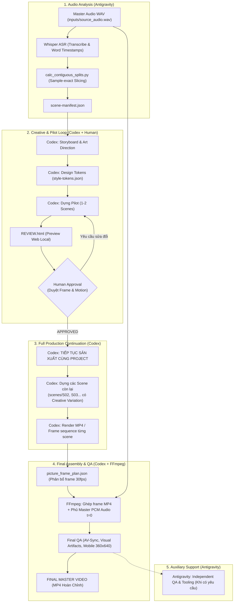

# BÁO CÁO SẴN SÀNG TRIỂN KHAI FLOW KIT V2 (IMPLEMENTATION READINESS REPORT)

- **Chức danh thực hiện:** Principal Software Architect, AI Workflow Engineer & Creative Motion Systems Architect
- **Dự án:** Flow Kit V2 — Codex-First 2D Motion Graphics & Advertising Video Engine
- **Trạng thái:** Kế hoạch Triển khai (Chưa chỉnh sửa source code hoặc instruction files theo Strict Rules)
- **Căn cứ:** Quyết định phê duyệt định hướng **CODEX-FIRST END-TO-END VIDEO PRODUCTION** của User.

---

## 1. FINAL CODEX-FIRST ARCHITECTURE

Kiến trúc Flow Kit V2 chính thức xác lập **Codex là Primary Production Agent**, loại bỏ sự phân mảnh giữa khâu sáng tạo và thi công:



---

## 2. FILES TO MODIFY (DANH MỤC TỆP CẦN ĐIỀU CHỈNH)

Các tệp được xác định cần cập nhật trong Phase A/B (chưa thực hiện sửa đổi):

| Đường dẫn Tệp | Nội dung Cần Điều chỉnh | Mục tiêu & Phạm vi |
|---|---|---|
| [`setup.py`](file:///d:/Năm%203/flowkit-main/setup.py) | • Sửa biến `_CRITICAL_RULES`, `_PIPELINE_OVERVIEW`.<br>• Cập nhật hàm `generate_codex()` để đồng bộ theo cấu trúc 5 khối.<br>• Loại bỏ quy định chừa footer 180–200px. | Đồng bộ template sinh `AGENTS.md`, chống bị ghi đè khi chạy `python setup.py sync`. |
| [`AGENTS.md`](file:///d:/Năm%203/flowkit-main/AGENTS.md) | • Tái cấu trúc thành 5 khối trách nhiệm.<br>• Xác lập Codex là Primary Production Agent, Antigravity là Audio/QA Agent.<br>• Xóa bỏ ràng buộc footer 180–200px, chuyển Mascot/Anti-Card thành linh hoạt. | Đảm bảo Codex CLI và Antigravity IDE auto-discover ngay khi khởi tạo phiên chat. |
| [`references/ANIMATION-STYLES.md`](file:///d:/Năm%203/flowkit-main/references/ANIMATION-STYLES.md) | Dòng 92: Bỏ câu *"Giữ footer phụ đề 180–200px trên canvas 720×1280"*. | Cho phép visual tràn canvas tự nhiên trong các phong cách Kurzgesagt/Isometric. |
| [`skills/fk-edu-motion-explainer.md`](file:///d:/Năm%203/flowkit-main/skills/fk-edu-motion-explainer.md) | Dòng 43: Xóa ràng buộc *"Keep the bottom 180-200px clear..."*. | Giải phóng không gian thiết kế cho motion explainer. |
| [`skills/fk-edu-motion-explainer.references/visual-design.md`](file:///d:/Năm%203/flowkit-main/skills/fk-edu-motion-explainer.references/visual-design.md) | Dòng 14 & 39: Bỏ Safe Area 180-200px bottom clearance. | Thay bằng quy tắc Safe Area đệm biên cân đối (dynamic padding). |
| [`skills/fk-edu-motion-explainer.references/motion-and-qa.md`](file:///d:/Năm%203/flowkit-main/skills/fk-edu-motion-explainer.references/motion-and-qa.md) | Dòng 19: Xóa tiêu chí đánh trượt visual khi chạm vào vùng footer 200px. | Cập nhật bộ tiêu chuẩn QA kiểm tra bố cục cân đối thay vì cấm chạm đáy. |
| [`skills/warm-doodle-video/SKILL.md`](file:///d:/Năm%203/flowkit-main/skills/warm-doodle-video/SKILL.md) | Dòng 69: Bỏ yêu cầu chừa footer phụ đề. | Giải phóng phong cách doodle vẽ tay. |

---

## 3. FILES TO PRESERVE (TỆP & MÔ-ĐUN BẢO TỒN NGUYÊN VẸN 100%)

Tuyệt đối không di chuyển, sửa đổi hoặc xóa các thành phần sau:
1. **Dữ liệu Lịch sử & Dự án Cũ trong [`videos/`](file:///d:/Năm%203/flowkit-main/videos/):**
   - Giữ nguyên toàn bộ: `VIDEO-33/`, `VIDEO-33-director-pilot/`, `tran-minh-nhat-*`, `le-pham-nhu-quynh-*`, `china-education-*`. Mọi file handoff cũ (`ANTIGRAVITY_PROMPT.md`, `TECHNICAL_HANDOFF.md`) được giữ lại như tư liệu lịch sử.
2. **Hạ tầng Google Flow Stack trong [`agent/`](file:///d:/Năm%203/flowkit-main/agent/):**
   - SQLite schema (`schema.py`, `crud.py`, `flow_agent.db`), WorkerController, MediaProvider SPI, API routes giữ nguyên vẹn để phục vụ khi có nhu cầu làm video AI footage.
3. **Chrome Extension Bridge trong [`extension/`](file:///d:/Năm%203/flowkit-main/extension/):**
   - Giữ nguyên `hijack_bypass.js`, `background.js`, `manifest.json`.
4. **Các Động cơ Render & Môi trường Thử nghiệm:**
   - [`remotion-project/`](file:///d:/Năm%203/flowkit-main/remotion-project/): Giữ nguyên mã nguồn React 19 và Remotion 4.0 làm engine tùy chọn.
   - [`hyperframes-demo/`](file:///d:/Năm%203/flowkit-main/hyperframes-demo/): Giữ nguyên làm môi trường đối chiếu CLI.
5. **Khả năng Sản xuất bằng Antigravity (Fallback Capability):**
   - Mặc dù Codex là primary, các chỉ dẫn vẫn bảo toàn khả năng nếu người dùng ra lệnh: *"Antigravity hãy sản xuất các scene còn lại"*, Antigravity vẫn có thể đọc `scene-manifest.json` và thi công bình thường.

---

## 4. INSTRUCTION MIGRATION PLAN (KẾ HOẠCH NÂNG CẤP CHỈ DẪN)

### Khung Cấu trúc `AGENTS.md` V2 (5 Khối Trách nhiệm)

```text
================================================================================
AGENTS.md V2 SPECIFICATION
================================================================================
1. GLOBAL RULES (Áp dụng cho mọi phiên làm việc)
   - Fact-checking bắt buộc (Tra cứu thực tế, không bịa đặt số liệu/sự kiện).
   - Tôn trọng dữ liệu Audio/Voice gốc (PCM sample bounds, không tự ý co giãn timing).
   - An toàn pháp lý: Tôn trọng bản quyền hình ảnh, thương hiệu và nhận diện cá nhân.

2. WORKFLOW ROUTING (Codex-First Pipeline)
   - Step 1: Audio Input (inputs/source_audio.wav).
   - Step 2: Antigravity Audio Analysis ➔ Xuất inputs/scene-manifest.json.
   - Step 3: Codex Creative Planning & Pilot ➔ Dựng S01/S05 + REVIEW.html.
   - Step 4: Human Approval ➔ Feedback loop trực tiếp với Codex cho đến khi duyệt.
   - Step 5: Codex Full Production ➔ Tiếp tục sản xuất S02..Sxx ngay trong thư mục đó.
   - Step 6: Codex Final Assembly ➔ Ghép frame 30fps + Phủ Master PCM Audio qua FFmpeg.

3. ENGINE ROUTING & CAPABILITIES
   - HyperFrames (@0.8.x): Engine mặc định cho 2D Vector, Mascot, Infographics, Doodle.
   - Remotion (@4.0.x): Engine tùy chọn khi cần Spring Physics, React UI Componentization.
   - Google Flow (Veo 2/3): Chỉ kích hoạt khi có yêu cầu sinh video footage AI thực tế.
     (Pre-flight kiểm tra cổng 8100 chỉ bắt buộc khi chạy chế độ này).

4. CREATIVE CONTRACTS (Phân loại 3 cấp độ thẩm mỹ)
   - 4.1. Universal Quality Rules: Full canvas balance, kiểm tra hiển thị mobile 360x640,
     100% font tiếng Việt đầy đủ dấu, AV-sync lệch < 1 frame ở 30fps.
   - 4.2. Style-Specific Guidelines: Anti-card, Accent budget, Dark mass, S-curves
     (chỉ kích hoạt khi kịch bản chọn phong cách tương ứng).
   - 4.3. Project-Specific Constraints: Tỷ lệ Mascot (nếu có), bảng màu thương hiệu,
     định dạng khung hình (9:16, 16:9, 1:1), subtitle động (chỉ bật khi có yêu cầu).

5. SKILL DISCOVERY & TOOL ROUTING
   - Bảng tra cứu các lệnh /fk-* cốt lõi và hướng dẫn nạp kỹ năng theo ngữ cảnh.
================================================================================
```

---

## 5. SKILLS CLEANUP PLAN (TINH GIẢN KHO SKILLS)

| Nhóm Skills | Hành động | Danh sách Cụ thể |
|---|---|---|
| **Core Production Skills (Giữ và Tối ưu)** | **KEEP** | `fk-research`, `fk-create-project`, `fk2-audio-analyzer`, `fk-review-board`, `fk-concat`. |
| **Engine Core Guidance** | **KEEP** | `hyperframes-core`, `hyperframes-animation`, `remotion-motion-director`. |
| **Candidate Guidance (0kb Runtime)** | **EVALUATE / ADD** | `greensock/gsap-skills` (Dạy AI cú pháp GSAP 3), `remotion-dev/skills` (Dạy AI pattern Remotion). |
| **Duplicate / Obsolete Skills** | **DEPRECATE** | • `fk-concat-fit-narrator` (gộp vào `fk-concat`).<br>• `general-video`, `faceless-explainer`, `motion-graphics` (hợp nhất chỉ dẫn vào `hyperframes-core`).<br>• `fk-change-model`, `fk-change-provider` (chuyển thành cấu hình file đơn giản). |
| **Excluded Skills** | **EXCLUDE** | Không nạp thêm các skill của Three.js, Rapier, Anime.js, Motion Canvas. |

---

## 6. MINIMAL PROJECT TEMPLATE (MẪU DỰ ÁN CODEX-FIRST)

Mẫu dự án chuẩn hóa cho các video sản xuất mới (ví dụ: `videos/VIDEO-34-marketing/`):

```text
videos/PROJECT_NAME/
├── project_manifest.json       # Metadata: Tên, audio source, resolution, fps, engine
├── inputs/
│   ├── source_audio.wav        # Audio master PCM 24kHz/48kHz
│   └── scene-manifest.json     # Sample bounds [start, end), raw ASR, corrected_text
├── creative/
│   ├── storyboard.md           # Kịch bản hình ảnh & thông điệp từng scene
│   └── style-tokens.json       # Mã màu, typography, paddings, visual hierarchy
├── assets/
│   ├── mascot/                 # Vector rig nhân vật (nếu có)
│   ├── props/                  # Đạo cụ vector dùng chung
│   └── motion-presets.js       # Các hàm GSAP easing/timeline mẫu
├── scenes/
│   ├── S01/ (Pilot đã duyệt: index.html, render.mp4)
│   ├── S02/ (Codex tiếp tục dựng)
│   └── ...
├── build/
│   ├── picture_frame_plan.json # Bảng phân bổ frame 30fps chính xác
│   └── final_master.mp4        # Video hoàn chỉnh cuối cùng
├── REVIEW.html                 # Web preview đối chiếu các scene
└── production_status.json      # Trạng thái từng cảnh (Planned -> Pilot -> Approved -> Done)
```

---

## 7. PILOT ACCEPTANCE CRITERIA (TIÊU CHUẨN NGHIỆM THU PILOT 15–20S)

Trước khi cho phép Codex sản xuất hàng loạt, Pilot mẫu (1–2 scene, dài 15–20s) phải vượt qua bảng kiểm định 7 tiêu chí:

| Tiêu chuẩn Nghiệm thu | Phương pháp Kiểm chứng | Tiêu chí Đạt (Pass Criteria) |
|---|---|---|
| **1. Visual Hierarchy & Depth** | Soi frame tĩnh mở đầu & kết thúc | Tối thiểu 3 lớp thị giác rõ rệt; tỷ lệ tương phản chữ đạt chuẩn đọc rõ trên mobile 360×640. |
| **2. Full Canvas Utilization** | Kiểm tra tỷ lệ khung hình | Không có khoảng trống bất thường ở đáy màn hình; visual dàn trải cân đối, không bị ép co cụm vào top 40%. |
| **3. Motion Intentionality** | Xem playback thời gian thực | Chuyển động có Anticipation (lấy đà) và Easing mượt mà (`back.out` hoặc `power2.out`); không có linear giật cục. |
| **4. Character Expressiveness** | Kiểm tra tương tác nhân vật | Nhân vật có hành động có nghĩa (semantic action: chỉ tay, tương tác đồ vật); không có nhân vật đứng nhún nhảy vô nghĩa. |
| **5. Scene-level Editability** | Thử sửa 1 màu sắc hoặc 1 chữ | Sửa trực tiếp trong `scenes/S01/index.html` và render lại độc lập thành công trong vòng < 10 giây. |
| **6. Audio-Visual Alignment** | Đo đạc waveform đối chiếu video | Hành động hình ảnh mở ra ăn khớp với nhịp câu nói trong voice; độ trôi lệch hình/tiếng < 1 frame (33ms). |
| **7. Headless Render Reliability** | Chạy CLI render MP4 | Render ra file MP4 mượt mà, không crash Puppeteer, không phụ thuộc kết nối internet bên ngoài. |

---

## 8. REGRESSION TEST PLAN (KẾ HOẠCH KIỂM THỬ HỒI QUY)

Đảm bảo các thay đổi không làm hỏng các dự án cũ và hạ tầng hiện hữu:

1. **Kiểm thử Tính toàn vẹn của Video cũ:**
   - Chạy lệnh kiểm tra render lại một cảnh cũ trong `videos/VIDEO-33-director-pilot/`:
     ```bash
     cd "videos/VIDEO-33-director-pilot/scenes/S01" && npx hyperframes check --at 0,1.5,3.3
     ```
   - Xác nhận: Cảnh cũ vẫn biên dịch và render bình thường mà không bị ảnh hưởng bởi quy chuẩn mới.
2. **Kiểm thử Google Flow Pre-flight Isolation:**
   - Khi chạy workflow 2D, xác nhận: Không có lệnh nào tự động ping `http://127.0.0.1:8100/health` gây block tiến trình của Codex.
3. **Kiểm thử Script Generator:**
   - Chạy thử nghiệm lệnh sync trong môi trường giả lập:
     ```bash
     python setup.py --tool codex
     ```
   - Xác nhận: `AGENTS.md` sinh ra giữ đúng 5 khối kiến trúc V2, không bị ghi đè trở lại các quy tắc cũ.

---

## 9. ROLLBACK STRATEGY (CHIẾN LƯỢC HOÀN NGUYÊN AN TOÀN)

Trong trường hợp có bất kỳ lỗi không mong muốn nào xảy ra trong quá trình triển khai:

1. **Bản sao lưu Dự phòng:**  
   Trước khi chỉnh sửa bất kỳ tệp nào, sao lưu nguyên bản:
   - `AGENTS.md` ➔ `AGENTS.md.bak`
   - `setup.py` ➔ `setup.py.bak`
   - `references/ANIMATION-STYLES.md` ➔ `references/ANIMATION-STYLES.md.bak`
2. **Quy trình Khôi phục Ngay lập tức (One-step Rollback):**
   Nếu phát hiện sự cố, chỉ cần thực hiện khôi phục từ tệp `.bak`:
   ```bash
   cp AGENTS.md.bak AGENTS.md
   cp setup.py.bak setup.py
   ```
   Hệ thống sẽ lập tức trở về 100% trạng thái ban đầu mà không để lại bất kỳ tác động phụ nào.

---

## 10. PROPOSED IMPLEMENTATION ORDER (LỘ TRÌNH THỰC HIỆN TỪNG BƯỚC)

```
[BƯỚC 1: CHUẨN BỊ & SAO LƯU] (Ưu tiên hàng đầu)
├── Tạo các bản sao lưu an toàn cho AGENTS.md, setup.py và ANIMATION-STYLES.md.
└── Trình User phê duyệt bắt đầu thực hiện Phase A.

[BƯỚC 2: PHASE A — INSTRUCTION & GENERATOR CLEANUP]
├── Cập nhật template trong setup.py (Chuẩn hóa 5 khối trách nhiệm, xóa bỏ footer 200px).
├── Chạy generator cập nhật AGENTS.md.
└── Cập nhật các tệp tham chiếu (ANIMATION-STYLES.md, fk-edu-motion-explainer.md).

[BƯỚC 3: PHASE B — DỰNG TEMPLATE DỰ ÁN CODEX-FIRST]
├── Chuẩn hóa thư mục mẫu videos/_template_codex_first/.
└── Đóng gói file mẫu style-tokens.json và motion-presets.js (GSAP 3).

[BƯỚC 4: PHASE C & D — CHẠY PILOT THỰC TẾ 15–20S & NGHIỆM THU]
├── Chọn 1 file voice ngắn có sẵn trong input_voice/.
├── Antigravity phân tích audio ➔ Codex thiết kế và dựng pilot.
├── Human nghiệm thu chất lượng theo 7 tiêu chí.
└── Codex hoàn thiện toàn bộ các scene còn lại ➔ Ghép video hoàn chỉnh.
```

---
*Báo cáo này đã được xuất bản và lưu trữ vĩnh viễn tại `FLOW_KIT_V2_IMPLEMENTATION_READINESS_REPORT.md` trong thư mục Artifacts của dự án.*
