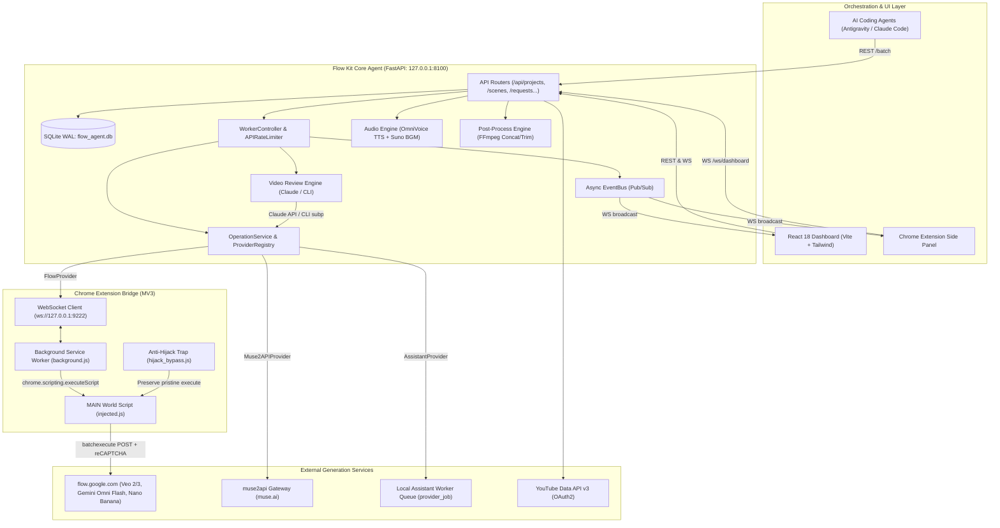

# 00. Executive Summary: Flow Kit Reverse-Engineering Report

## 1. Project Overview & Mission
**Flow Kit** is an advanced, production-grade automated video generation, chaining, and publishing orchestration platform. It is engineered to bridge local AI development agents (such as Antigravity, Claude Code, and Codex) with web-scale video and image generation backends—predominantly **Google Flow (`flow.google.com`)**, **Gemini Omni Flash**, **Veo 2/3**, **muse.ai**, and local AI assistants.

The system solves a fundamental engineering challenge: **Google Flow does not expose a public developer API with persistent tokens, and its web interface is protected by session cookies, per-page WIZ tokens, and Enterprise reCAPTCHA with sophisticated anti-extension traps.** Flow Kit overcomes this through a multi-tier hybrid architecture:
1. A **FastAPI Backend Server (`agent/`)** managing projects, scenes, character bibles, request queues, video assembly, TTS, and video review.
2. An **Event-Driven Background Worker (`agent/worker/processor.py`)** with provider-aware concurrency gates, rate limiting, and dependency resolution.
3. A **Pluggable Media Provider Subsystem (`agent/sdk/services/`)** abstracting heterogeneous generation engines (`flow`, `assistant`, `muse2api`).
4. An **In-Browser Chrome Extension Bridge (MV3, `extension/`)** that establishes a persistent WebSocket connection to the local agent, injects into `flow.google.com`'s `MAIN` world, bypasses Google's reCAPTCHA monkeypatch traps (`hijack_bypass.js`), and executes Google's proprietary `batchexecute` RPC protocol natively using the active browser session.
5. An **Automated AI Video Reviewer (`agent/services/video_reviewer.py`)** scoring generated clips across 6 weighted dimensions (character consistency, prompt adherence, motion quality, visual fidelity, temporal coherence, composition) using Claude Vision or local CLI agents, triggering automatic prompt mutations and regenerations.
6. An **End-to-End Post-Production Engine (`agent/services/post_process.py`, `tts.py`, `suno.py`, `youtube/`)** handling OmniVoice TTS, Suno AI background music, FFmpeg normalization/trimming/concatenation, and automated YouTube Shorts/Long-form scheduled uploads.

---

## 2. Key Architectural Metrics & Discoveries

| Metric / Dimension | Value / Discovery | Evidence in Codebase |
|---|---|---|
| **Primary Languages** | Python (Backend & Workers), TypeScript/React (Dashboard), JavaScript (Extension) | `agent/`, `dashboard/`, `extension/` |
| **Backend Framework** | FastAPI (ASGI) + Uvicorn + WebSockets | `agent/main.py`, `agent/config.py` |
| **Database** | SQLite3 via `aiosqlite` with WAL mode & Foreign Keys | `agent/db/schema.py`, `agent/db/crud.py` |
| **Extension Architecture** | Chrome MV3 with service worker, `declarativeNetRequest`, MAIN world script injection | `extension/manifest.json`, `background.js` |
| **RPC Wire Protocol** | Google `batchexecute` (`/_/AiSandboxAngularFrontend/data/batchexecute`) | `agent/services/flow_batch.py` |
| **Anti-Bot Defense Bypass** | 3-tier Property Trap in MAIN world neutralizing Google's `x2a` tamper script | `extension/hijack_bypass.js` |
| **Media Provider Abstraction** | Clean Provider Interface (`MediaProvider`), `ProviderRegistry`, `OperationService` | `agent/sdk/services/` |
| **Review & Auto-Regen** | 6-factor weighted vision scoring; automates prompt refinement if score < 7.5 | `agent/services/video_reviewer.py` |
| **Realtime Monitoring** | Bi-directional WebSocket pub/sub (`event_bus`) feeding React Dashboard & Extension Side Panel | `agent/main.py#L426`, `dashboard/src/` |

---

## 3. High-Level System Architecture

---

## 4. Key Takeaways for System Customization & Operation
1. **Zero Core Disruption via MediaProvider Interface**: Adding a new image or video generation backend (e.g. OpenAI Sora, Runway Gen-3, local ComfyUI/SDXL) requires subclassing `MediaProvider` in `agent/sdk/services/provider_base.py` and registering it in `ProviderRegistry` without touching API endpoints or schema.
2. **Rate Limiting & Concurrency Safety**: The worker enforces strict concurrency limits and cooldown timers per provider (Flow: 5 concurrent, 10s cooldown; assistant: 2 concurrent; muse2api: 2 concurrent) to prevent IP bans and Google `PUBLIC_ERROR_UNUSUAL_ACTIVITY` rejections.
3. **Session Resiliency**: By executing batchexecute calls directly within the logged-in browser tab via `chrome.scripting.executeScript` in the `MAIN` world, authentication, cookies, and CSRF tokens are handled natively without needing token scraping or reverse-proxy authentication.
4. **Scene Continuity Guarantee**: Scene continuation (`scene_chain.py`) carries forward the `vertical_end_scene_media_id` / `horizontal_end_scene_media_id` from the parent scene to the next scene's start frame, ensuring visual coherence across scene cuts.
