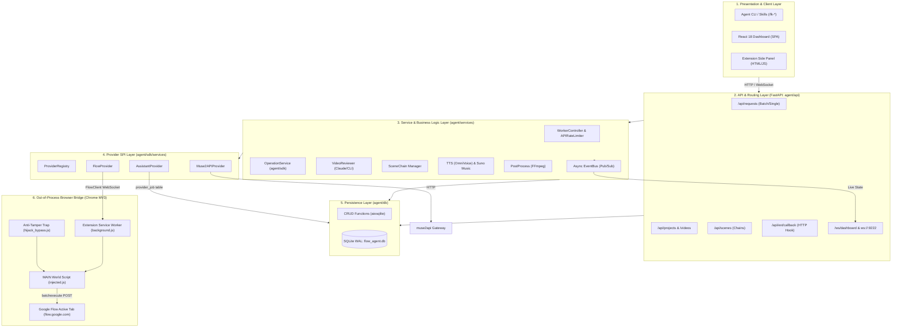

# 03. System Architecture & Component Interaction

## 1. Architectural Pattern: Layered Modular Monolith with Out-of-Process Hybrid Bridge

Flow Kit implements a **Layered Modular Monolith** combined with an **Asynchronous Out-of-Process Browser Bridge (Hexagonal / Port-and-Adapter architecture)**.

---

## 2. Architectural Layers & Responsibilities

### Layer 1: Presentation & Client Layer
- **CLI / Skills (`skills/`, `.agents/skills`)**: Declarative markdown instructions empowering external AI agents (Antigravity, Claude Code, Codex) to invoke Flow Kit endpoints in batch mode without writing one-off scripts.
- **Dashboard (`dashboard/`)**: Single-page React application for project management, scene gallery, pipeline visualization, and log monitoring. Connects via WebSocket to receive live event updates.
- **Extension Side Panel (`extension/side_panel.html`)**: Native browser side-panel providing live generation telemetry directly next to Google Flow tabs.

### Layer 2: API & Controller Layer (`agent/api/`)
- 14 modular routers registered in `agent/main.py`.
- **Stateless Controllers**: Handlers validate requests via Pydantic schemas, interact with `agent/db/crud.py`, or trigger asynchronous jobs.
- **Dual-Transport RPC Handshake**:
  - Outgoing commands sent over WebSocket to the Chrome Extension.
  - Incoming RPC responses delivered either via WebSocket or resiliently via `POST /api/ext/callback` with an internal bearer secret (`_CALLBACK_SECRET`), ensuring response delivery even if the WebSocket disconnects during long generations.

### Layer 3: Service & Orchestration Layer (`agent/services/` & `agent/sdk/`)
- **Worker Controller (`agent/worker/processor.py`)**: Central dispatcher loop. Emits `worker_tick` events, verifies scene prerequisites, manages per-provider concurrency via `APIRateLimiter`, and executes operations asynchronously.
- **Event Bus (`agent/services/event_bus.py`)**: Asynchronous in-memory pub/sub broadcasting state changes (`request_update`, `worker_tick`, `log_entry`) to all connected dashboard WebSockets.
- **Scene Chain Manager (`agent/services/scene_chain.py`)**: Enforces continuity across video scenes by linking end-frame media IDs of parent scenes into subsequent scenes.
- **Video Reviewer (`agent/services/video_reviewer.py`)**: Visual quality assurance engine implementing frame extraction and AI multi-dimensional scoring.
- **Audio & Post-Production (`agent/services/tts.py`, `post_process.py`)**: Subprocess execution for OmniVoice and FFmpeg, preventing GIL blockage or native library crashes in the main server loop.

### Layer 4: Provider SPI (Service Provider Interface) Layer
- Defined under `agent/sdk/services/`.
- Uses a unified domain model `ProviderJob` representing any generation task (image, edit, video, video with refs, upscale).
- `ProviderRegistry` resolves the concrete provider (`flow`, `assistant`, `muse2api`) based on request attributes or project defaults.
- This layer fully abstracts third-party backends: the core worker and database schema remain completely agnostic to whether media is generated by Google Flow, an AI assistant, or muse.ai.

### Layer 5: Data & Persistence Layer (`agent/db/`)
- Pure asynchronous SQLite interface via `aiosqlite`.
- Uses **Write-Ahead Logging (`PRAGMA journal_mode=WAL`)** and strict foreign key constraints (`PRAGMA foreign_keys=ON`).
- Includes a singleton connection manager with lazy loop-bound locking (`_get_db_init_lock`) to eliminate connection leaks and pytest event loop conflicts.
- Houses embedded migration scripts executed during `init_db()`.

### Layer 6: Out-of-Process Browser Bridge (Chrome MV3)
- Solves the authentication and security barrier of `flow.google.com`.
- **Anti-Hijack Property Trap (`extension/hijack_bypass.js`)**: Runs at `document_start` in the page's `MAIN` world. Intercepts the pristine `grecaptcha.enterprise.execute` function before Google Flow's front-end script `x2a` can wrap it with an intentional poison action (`action: "extension_hijack_detected"`).
- **In-Page Executor (`extension/injected.js` & `background.js`)**: Gathers per-page WIZ tokens (`SNlM0e`, `FdrFJe`, `cfb2h`), mints a fresh Enterprise reCAPTCHA token using the pristine execute function, and issues `batchexecute` POST requests carrying the user's active session cookies.

---

## 3. Coupling & Boundary Analysis

| Boundary | Coupling Level | Mechanism | Decoupling Strategy |
|---|---|---|---|
| **API -> Database** | Medium | Direct async CRUD calls (`agent/db/crud.py`) | Pydantic DTOs isolate API contracts from DB rows |
| **Worker -> Generation Backends** | Very Low | `MediaProvider` Interface & `ProviderRegistry` | New providers implement `provider_base.py` without worker changes |
| **Backend -> Extension** | Low | JSON-RPC over WebSocket + HTTP Callback | Protocol versioning and graceful fallback if disconnected |
| **Backend -> Video Reviewer** | Low | CLI subprocess or HTTP REST (Anthropic SDK) | Abstracted in `cli_providers.py`; switchable via `providers.json` |
| **Backend -> Post-Production** | Low | Subprocess isolation (`ffmpeg`, `python tts`) | Eliminates library conflicts; non-zero exits captured safely |
