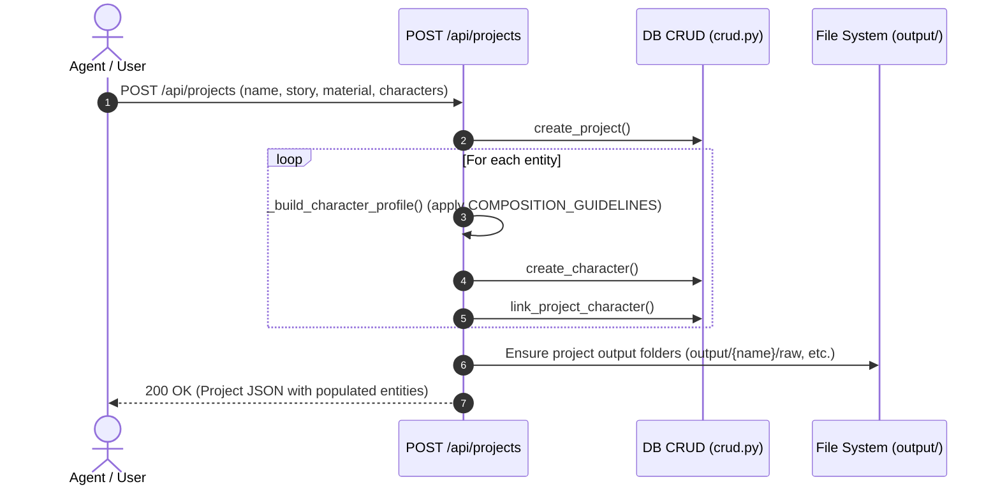
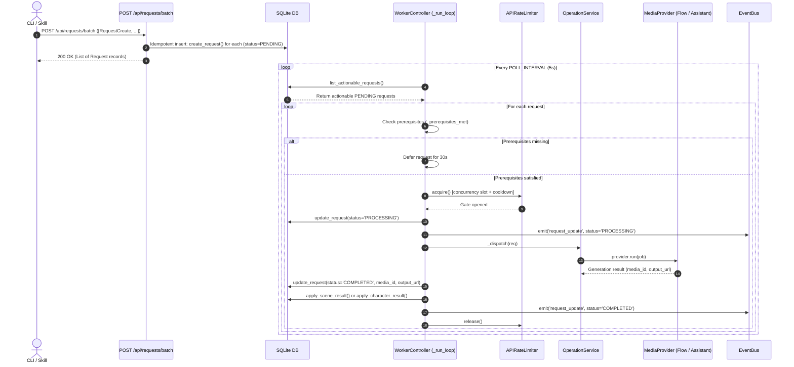
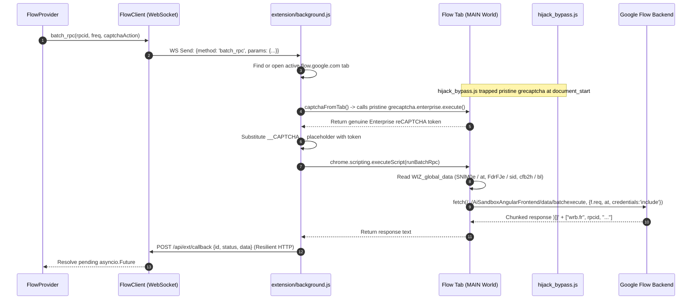
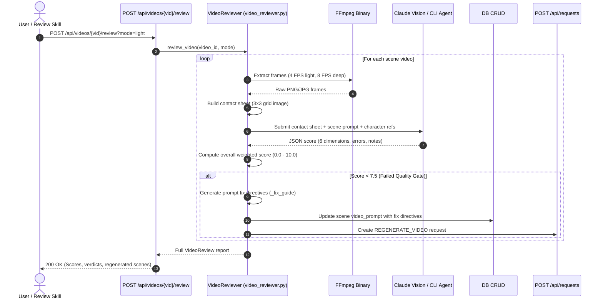
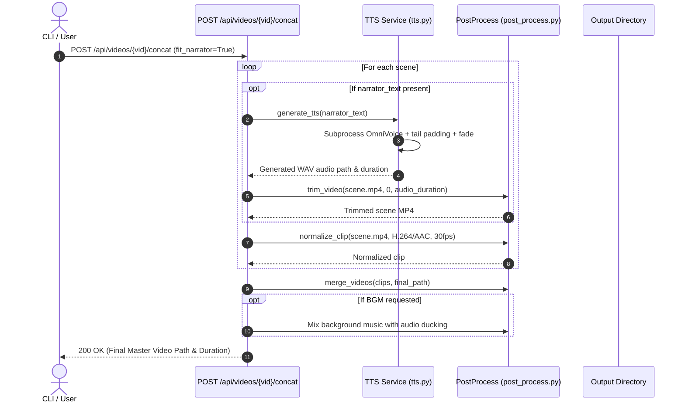

# 05. End-to-End Workflow Analysis

## Workflow 1: Project Creation & Character Bible Inception

| Step | Module | File | Function | Input | Output | Responsibility |
|---|---|---|---|---|---|---|
| 1 | API | `agent/api/projects.py` | `create()` | `ProjectCreate` payload | Project JSON | Validates input, generates UUIDs, sets paygate tier & material. |
| 2 | Logic | `agent/api/projects.py` | `_build_character_profile()` | Entity metadata & story | Image prompt + description | Applies orientation (portrait for characters, landscape for locations) and style guidelines. |
| 3 | Database | `agent/db/crud.py` | `create_character()` | Entity dictionary | Character record | Persists character/location with generated slug. |
| 4 | Storage | `agent/api/projects.py` | `Path.mkdir()` | Output directory path | Directory tree | Prepares `output/{project_name}/raw`, `review_full`, etc. |

---

## Workflow 2: Asynchronous Request Batch Pipeline & Worker Dispatch

| Step | Module | File | Function | Input | Output | Responsibility |
|---|---|---|---|---|---|---|
| 1 | API | `agent/api/requests.py` | `create_batch()` | `BatchRequestCreate` | List of `Request` | Ingests requests atomically, auto-sets video orientation, skips active duplicates. |
| 2 | Worker | `agent/worker/processor.py` | `_run_loop()` | - | PENDING requests | Queries queue, orders by priority (character > image > video > upscale). |
| 3 | Worker | `agent/worker/processor.py` | `_prerequisites_met()` | `req`, `orientation` | Boolean | Checks that image exists before video gen, and video exists before upscale. |
| 4 | Worker | `agent/worker/processor.py` | `APIRateLimiter.acquire()` | - | - | Throttles requests per provider (e.g. 5 concurrent, 10s cooldown for Flow). |
| 5 | Orchestrator | `agent/sdk/services/operations.py` | `_run_provider_job()` | `ProviderJob` | Result Dict | Resolves provider via registry, verifies capabilities, calls `provider.run()`. |
| 6 | Database | `agent/sdk/services/result_handler.py` | `apply_scene_result()` | `media_id`, `output_url` | DB update | Writes image/video URLs and media IDs into `scene` table. |
| 7 | Events | `agent/services/event_bus.py` | `emit()` | Event JSON | Broadcast | Pushes real-time progress to connected dashboard clients. |

---

## Workflow 3: Google Flow Chrome Extension BatchRPC & Anti-Detection Bypass

| Step | Module | File | Function | Input | Output | Responsibility |
|---|---|---|---|---|---|---|
| 1 | Service | `agent/services/flow_client.py` | `batch_rpc()` | RPC ID, freq payload | Pending Future | Creates promise tracked in `_pending[req_id]`, forwards command over WebSocket. |
| 2 | Extension | `extension/background.js` | `handleBatchRpc()` | WS message | Injected execution | Identifies candidate Flow tab; triggers tab revival if discarded by Chrome. |
| 3 | Extension | `extension/hijack_bypass.js` | `savePristine()` | Function reference | `window.__fk_hijack` | Intercepts original reCAPTCHA execute before Google's `x2a` tamper script wraps it. |
| 4 | Extension | `extension/background.js` | `captchaFromTab()` | `captchaAction` | reCAPTCHA Token | Executes in-page token mint using unpoisoned function. |
| 5 | In-Page | `extension/background.js` | `runBatchRpc()` | RPC parameters | HTTP Response text | Extracts `WIZ_global_data.SNlM0e` (`at` token) and performs browser fetch with session cookies. |
| 6 | Bridge | `agent/main.py` | `ext_callback()` | Result payload + Secret | Confirmation | HTTP fallback callback that sets result on `_pending[req_id]` Future. |

---

## Workflow 4: Video Quality Review & Auto-Regeneration Loop

| Step | Module | File | Function | Input | Output | Responsibility |
|---|---|---|---|---|---|---|
| 1 | API | `agent/api/reviews.py` | `review_video_endpoint()` | `video_id`, `mode` | `VideoReview` JSON | Entry point for automated visual quality assessment. |
| 2 | Service | `agent/services/video_reviewer.py` | `_extract_frames()` | Video file path, FPS | Frame image files | Uses FFmpeg to extract sequential video frames into temporary storage. |
| 3 | Service | `agent/services/video_reviewer.py` | `_build_contact_sheet()` | Frame array | Single JPEG image | Assembles 9 frames into a 3x3 contact sheet for token-efficient vision analysis. |
| 4 | Vision | `agent/services/video_reviewer.py` | `_call_vision_cli()` or API | Sheet image + Prompt | Dimension scores | Prompts Claude / CLI reviewer to grade visual quality across 6 weighted dimensions. |
| 5 | QA Gate | `agent/services/video_reviewer.py` | `_compute_overall()` | Dimension scores | Overall score | Computes weighted score. Triggers auto-regen if score < 7.5 (up to 2 cycles). |

---

## Workflow 5: Narration, Music & Final Video Assembly

| Step | Module | File | Function | Input | Output | Responsibility |
|---|---|---|---|---|---|---|
| 1 | Audio | `agent/services/tts.py` | `generate_tts()` | `narrator_text`, voice ref | WAV audio file | Executes OmniVoice in isolated subprocess; appends 0.4s silence and 0.06s fade-out. |
| 2 | FFmpeg | `agent/services/post_process.py` | `trim_video()` | Video path, start, end | Trimmed MP4 | Trims scene video exactly to narrator speech duration. |
| 3 | FFmpeg | `agent/services/post_process.py` | `normalize_clip()` | Clip path | Standardized MP4 | Transcodes video to uniform `h264/yuv420p` + 48kHz AAC stereo. |
| 4 | FFmpeg | `agent/services/post_process.py` | `merge_videos()` | List of clip paths | Concat text demuxer | Concatenates normalized clips using FFmpeg concat demuxer without re-encoding. |
