# 06. Data Architecture & State Management

## 1. Relational Entity-Relationship Diagram

```mermaid
erDiagram
    PROJECT ||--o{ PROJECT_CHARACTER : links
    CHARACTER ||--o{ PROJECT_CHARACTER : belongs_to
    PROJECT ||--o{ VIDEO : contains
    VIDEO ||--o{ SCENE : contains
    SCENE ||--o{ SCENE : chains_to
    PROJECT ||--o{ REQUEST : tracks
    VIDEO ||--o{ REQUEST : tracks
    SCENE ||--o{ REQUEST : tracks
    CHARACTER ||--o{ REQUEST : tracks
    MATERIAL ||--o{ PROJECT : styles

    PROJECT {
        string id PK
        string name
        string description
        string story
        string thumbnail_url
        string language
        string status
        string user_paygate_tier
        string narrator_voice
        string narrator_ref_audio
        string material FK
        integer allow_music
        integer allow_voice
        string video_model_family
        string created_at
        string updated_at
    }

    CHARACTER {
        string id PK
        string name
        string slug
        string entity_type
        string description
        string image_prompt
        string voice_description
        string reference_image_url
        string media_id
        string created_at
        string updated_at
    }

    PROJECT_CHARACTER {
        string project_id PK, FK
        string character_id PK, FK
    }

    MATERIAL {
        string id PK
        string name
        string style_instruction
        string negative_prompt
        string scene_prefix
        string lighting
        string created_at
    }

    VIDEO {
        string id PK
        string project_id FK
        string title
        string description
        integer display_order
        string status
        string vertical_url
        string horizontal_url
        string thumbnail_url
        real duration
        real target_duration_s
        string resolution
        string orientation
        string youtube_id
        string privacy
        string tags
        string created_at
        string updated_at
    }

    SCENE {
        string id PK
        string video_id FK
        integer display_order
        string prompt
        string image_prompt
        string video_prompt
        string character_names
        string parent_scene_id FK
        string chain_type
        string source
        string vertical_image_url
        string vertical_image_media_id
        string vertical_image_status
        string vertical_video_url
        string vertical_video_media_id
        string vertical_video_status
        string vertical_upscale_url
        string vertical_upscale_media_id
        string vertical_upscale_status
        string horizontal_image_url
        string horizontal_image_media_id
        string horizontal_image_status
        string horizontal_video_url
        string horizontal_video_media_id
        string horizontal_video_status
        string horizontal_upscale_url
        string horizontal_upscale_media_id
        string horizontal_upscale_status
        string vertical_end_scene_media_id
        string horizontal_end_scene_media_id
        real trim_start
        real trim_end
        real duration
        string transition_prompt
        string narrator_text
        string created_at
        string updated_at
    }

    REQUEST {
        string id PK
        string project_id FK
        string video_id FK
        string scene_id FK
        string character_id FK
        string type
        string orientation
        string status
        string request_id
        string media_id
        string output_url
        string error_message
        integer retry_count
        string next_retry_at
        string edit_prompt
        string source_media_id
        string provider
        string created_at
        string updated_at
    }

    PROVIDER_JOB {
        string id PK
        string provider
        string kind
        string status
        string prompt
        string orientation
        string source_url
        string start_url
        string end_url
        string extra
        string claimed_by
        string claimed_at
        string lease_expires_at
        integer progress
        string progress_message
        string result
        string error_message
        integer retry_count
        string created_at
        string updated_at
    }
```

---

## 2. Table Specifications & Constraints

### 2.1 `project`
- **Key Fields**: `id` (UUID), `name`, `story`, `material`, `video_model_family` (`veo` or `omni_flash`).
- **Constraints**:
  - `status CHECK(status IN ('ACTIVE','ARCHIVED','DELETED'))`.
- **Relationships**: Parent of `video`, `project_character`, and `request`.

### 2.2 `character` (Reference Entities)
- **Key Fields**: `id`, `name`, `slug`, `entity_type`, `media_id` (Google Flow reference UUID).
- **Constraints**:
  - `entity_type CHECK(entity_type IN ('character','location','creature','visual_asset','generic_troop','faction'))`.
- **Orientation Rules**: `location` defaults to Landscape (16:9); all other entities default to Portrait (9:16).

### 2.3 `video`
- **Key Fields**: `id`, `project_id`, `orientation` (`VERTICAL` or `HORIZONTAL`), `target_duration_s`, `youtube_id`.
- **Constraints**:
  - `status CHECK(status IN ('DRAFT','PROCESSING','COMPLETED','FAILED'))`.
  - `orientation CHECK(orientation IN ('VERTICAL','HORIZONTAL'))`.

### 2.4 `scene`
- **Key Fields**: `id`, `video_id`, `parent_scene_id`, `chain_type` (`ROOT`, `CONTINUATION`, `INSERT`).
- **Media Tracking**: Tracks separate vertical and horizontal URLs, media IDs, and status flags (`vertical_image_status`, `vertical_video_status`, `vertical_upscale_status`).
- **Continuity Chaining**: Fields `vertical_end_scene_media_id` and `horizontal_end_scene_media_id` hold the parent scene's video media ID to seed continuation video generation.

### 2.5 `request` (Work Queue)
- **Key Fields**: `id`, `project_id`, `video_id`, `scene_id`, `character_id`, `type`, `status`, `provider`.
- **Constraints**:
  - `status CHECK(status IN ('PENDING','PROCESSING','COMPLETED','FAILED'))`.
  - `type CHECK(type IN ('GENERATE_IMAGE','REGENERATE_IMAGE','EDIT_IMAGE','GENERATE_VIDEO','REGENERATE_VIDEO','GENERATE_VIDEO_REFS','UPSCALE_VIDEO','GENERATE_CHARACTER_IMAGE','REGENERATE_CHARACTER_IMAGE','EDIT_CHARACTER_IMAGE'))`.

### 2.6 `provider_job` (Decoupled External Queue)
- **Key Fields**: `id`, `provider`, `kind`, `status`, `claimed_by`, `lease_expires_at`, `progress`, `result`.
- **Constraints**:
  - `status CHECK(status IN ('QUEUED','CLAIMED','RUNNING','SUCCEEDED','FAILED','CANCELLED'))`.
- **Leasing Model**: External workers obtain a time-bound lease (`lease_expires_at`). If a worker crashes, the lease expires and the job becomes reclaimable by another worker without stalling the pipeline.

---

## 3. Database Indexes

To guarantee sub-millisecond query response under large project chains, the following indexes are declared in `schema.py`:
- `idx_scene_video` on `scene(video_id)`
- `idx_scene_order` on `scene(video_id, display_order)`
- `idx_request_status` on `request(status)`
- `idx_request_scene` on `request(scene_id)`
- `idx_video_project` on `video(project_id)`
- `idx_provider_job_provider_status` on `provider_job(provider, status)`
- `idx_provider_job_lease` on `provider_job(lease_expires_at)`
