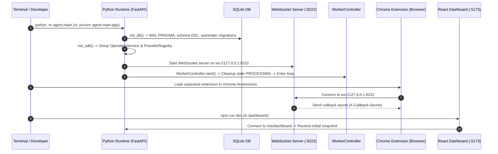

# 08. Execution, Build, Test & Deployment Lifecycle

## 1. Local Development Startup Sequence

To run Flow Kit locally from scratch, the system executes through the following distinct lifecycle stages:



---

## 2. Environment Variables Reference

| Variable | Default Value | Purpose |
|---|---|---|
| `API_HOST` | `127.0.0.1` | Host interface for FastAPI HTTP server. |
| `API_PORT` | `8100` | Port for FastAPI HTTP server. |
| `WS_HOST` | `127.0.0.1` | Host interface for extension WebSocket server. |
| `WS_PORT` | `9222` | Port for extension WebSocket server. |
| `DEFAULT_PROVIDER` | `flow` | Default generation backend (`flow`, `assistant`, `muse2api`). |
| `FLOW_PROJECT_ID` | `""` | UUID of pinned Google Flow project. |
| `FLOW_GENERATION_MIN_INTERVAL_S` | `3` | Process-wide minimum seconds between Google Flow generations. |
| `FLOW_GENERATION_MAX_CONCURRENT` | `1` | Concurrency limit for CAPTCHA-bearing direct generation calls. |
| `FLOW_UNUSUAL_ACTIVITY_COOLDOWN_S` | `120` | Cooldown period triggered when Google returns `UNUSUAL_ACTIVITY`. |
| `ANTHROPIC_API_KEY` | `""` | API key for direct Claude Vision video quality evaluations. |
| `REVIEW_MODEL` | `claude-haiku-4-5-20251001` | Vision model used for reviewing video contact sheets. |
| `SUNO_API_KEY` | `""` | API key for Suno music generation (api.sunoapi.org). |
| `TTS_MODEL` | `k2-fsa/OmniVoice` | HuggingFace model key for local neural speech synthesis. |
| `TTS_DEVICE` | `cpu` | Device for PyTorch TTS (`cpu` recommended; avoids MPS/CUDA memory fragmentation). |
| `MUSE2API_URL` | `""` | Gateway URL for muse.ai OpenAI-compatible generation. |
| `MUSE2API_KEY` | `""` | Gateway API key for muse2api. |

---

## 3. Operational Build & Run Commands

### 3.1 Backend Server
```bash
# 1. Activate Python virtual environment
source venv/bin/activate  # On Linux/macOS
.\venv\Scripts\Activate.ps1  # On Windows PowerShell

# 2. Run backend server
python -m agent.main
# Server runs on http://127.0.0.1:8100 with WebSocket bridge on ws://127.0.0.1:9222
```

### 3.2 Chrome Extension Bridge
1. Open Google Chrome and navigate to `chrome://extensions/`.
2. Enable **Developer mode** (toggle in top-right corner).
3. Click **Load unpacked** and select the `flowkit-main/extension/` folder.
4. Pin the Flow Kit extension icon.
5. Open `https://flow.google.com/` in an active browser tab and sign into your Google account.
6. Check extension popup: It should report `Agent: Connected` and `Flow Tab: Ready`.

### 3.3 Dashboard (Optional)
```bash
cd dashboard
npm install
npm run dev
# Dashboard available at http://localhost:5173
```

### 3.4 Standalone Review Board
```bash
python tools/review_server.py 8200
# Review board available at http://127.0.0.1:8200
```

---

## 4. Troubleshooting & Deployment Pitfalls

1. **`Extension not connected` (HTTP 503)**:
   - Ensure the Chrome extension is loaded and active.
   - Verify `ws://127.0.0.1:9222` is not blocked by local firewalls or another process.
   - Click the extension icon and hit `Reconnect`.
2. **Google Flow `PUBLIC_ERROR_UNUSUAL_ACTIVITY`**:
   - Google Flow's bot defense detected rapid generation calls or an invalid reCAPTCHA token.
   - Ensure `extension/hijack_bypass.js` is loaded at `document_start`.
   - Verify `FLOW_COOLDOWN_S` is set to at least 10s. Refresh the `flow.google.com` tab to mint fresh session tokens.
3. **TTS `Expected 2D Tensor, got 1D`**:
   - Resolved automatically in `agent/services/tts.py:_to_wav_tensor()`, which reshapes 1D numpy arrays into 2D torch tensors before saving.
4. **FFmpeg Concatenation Codec Mismatches**:
   - Different providers may output varying frame rates or pixel formats.
   - Always run `normalize_clip()` prior to `merge_videos()` so clips share `libx264/yuv420p` and 48kHz AAC.
